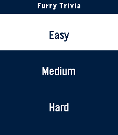

<!-- Generated by scripts/update_app_directory.py: do not edit by hand -->
[← All Pebble Developers](../developers.md)

# Furchee

*2 apps · Last updated 2026-10-11 · [About these lists](../about-app-lists.md)*

Links: [Pebble App Store](https://apps.repebble.com/apps/dev/furchee_1bb35cbb1c9e9aa2b06fb7d0) · [GitHub (Furchee)](https://github.com/Furchee) · [Website (furchee.com)](https://furchee.com)

<button type="button" data-filter="all" aria-pressed="true">All 2</button><button type="button" data-filter="watchface" aria-pressed="false" disabled>Watchfaces 0</button><button type="button" data-filter="watchapp" aria-pressed="false">Apps 2</button>

<label class="dev-sort">Sort by <select><option value="updated">Recently updated</option><option value="released">Newest release</option><option value="title">A–Z</option></select></label>

<h2 class="app-name" id="app-f36098fd376a43f2965478cc"><a href="https://apps.repebble.com/f36098fd376a43f2965478cc">Cheetah&#x27;s Wordle</a> v3.0.4</h2>
<a class="app-source" href="https://github.com/Furchee/Furchee-s-Wordle" title="Source code" data-search-exclude>View source</a>

App · <a href="https://forum.rebble.io/t/1274" title="Discuss this app on the Rebble forum" data-search-exclude>Forum thread</a>

No licence Released 2026-08-23 Updated 2026-09-26

Runs on: Round 2, Time 2, Pebble 2 Duo, Pebble 2, Time Round, Time, Classic

Furchee&#x27;s Wordle A fully working Wordle Game for the pebble smart watch! I made a better one because I like wordle. Tested the round screen versions using the emulator. Let me know if it doesn&#x27;t…

<h2 class="app-name" id="app-0c2054e85055424aae83ff94"><a href="https://apps.repebble.com/0c2054e85055424aae83ff94">Furry Trivia</a> v1.1.0</h2>
<a class="app-source" href="https://github.com/Furchee/Furry-Trivia" title="Source code" data-search-exclude>View source</a>

App

No licence Released 2026-08-29 Updated 2026-09-03

Runs on: Round 2, Time 2, Pebble 2 Duo, Pebble 2, Time Round, Time, Classic

A simple trivia game pertaining to the furry fandom! Play it alone or with friends and test your knowledge. I&#x27;ve tested the ability to play this on round screens and I believe I&#x27;ve done a good job…

