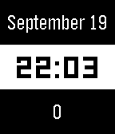

<!-- Generated by scripts/update_app_directory.py: do not edit by hand -->
[← All Pebble Developers](../developers.md)

# Furfx

*1 watchface · Last updated 2026-10-12 · [About these lists](../about-app-lists.md)*

Links: [Rebble App Store](https://apps.rebble.io/en_US/developer/578e4db484242884d6000091/1)

<h2 class="app-name" id="app-59c177830dfc32dd14001de1"><a href="https://apps.rebble.io/en_US/application/59c177830dfc32dd14001de1">DayDateSteps</a> v1.0</h2>
<a class="app-source" href="https://pastebin.com/k21wFaGp" title="Source code" data-search-exclude>View source</a>

Watchface

Released 2017-09-19 Updated 2017-09-19 Rebble App Store

Runs on: Time 2, Pebble 2 Duo, Pebble 2

Simple watchface made as a programming test. Shows the current date and steps.

