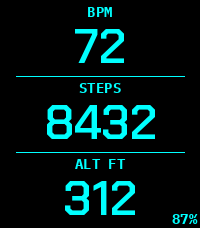

<!-- Generated by scripts/update_app_directory.py: do not edit by hand -->
[← All Pebble Developers](../developers.md)

# futur3gentleman

*1 watchface · Last updated 2026-10-11 · [About these lists](../about-app-lists.md)*

Links: [Rebble App Store](https://apps.rebble.io/en_US/developer/6aa1b33922335f0009c19eaa/1) · [GitHub (futur3gentleman)](https://github.com/futur3gentleman) · [Website (futur3gentleman.com)](https://futur3gentleman.com)

<h2 class="app-name" id="app-6aa1b542c73fab0009866df1"><a href="https://apps.rebble.io/en_US/application/6aa1b542c73fab0009866df1">pebble_deck Bigface</a> v1.2.0</h2>
<a class="app-source" href="https://github.com/futur3gentleman/pebble_deck_bigface/tree/bigface" title="Source code" data-search-exclude>View source</a>

Watchface · <a href="https://forum.rebble.io/t/1345" title="Discuss this app on the Rebble forum" data-search-exclude>Forum thread</a>

Released 2026-09-09 Updated 2026-09-09 Rebble App Store

Runs on: Time 2

Display 3 pieces of information with a large font. Ideal if you use the Pebble as a second watch. This is a fork of the pebble_deck watchface.

