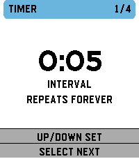

<!-- Generated by scripts/update_app_directory.py: do not edit by hand -->
[← All Pebble Developers](../developers.md)

# G-Cyrille

*1 app · Last updated 2026-10-12 · [About these lists](../about-app-lists.md)*

Links: [Pebble App Store](https://apps.repebble.com/apps/dev/g-cyrille_923e7c387ccf5ef604ebe025) · [GitHub (G-Cyrille)](https://github.com/G-Cyrille)

<h2 class="app-name" id="app-f64d58f70cb8458390cd7749"><a href="https://apps.repebble.com/f64d58f70cb8458390cd7749">Tick Every</a> v1.2.2</h2>
<a class="app-source" href="https://github.com/G-Cyrille/tick-every" title="Source code" data-search-exclude>View source</a>

App

MIT Released 2026-08-07 Updated 2026-08-13

Runs on: Round 2, Time 2, Pebble 2 Duo, Pebble 2, Time Round, Time, Classic

Supports: Aplite, Basalt, Chalk, Diorite, Emery, Flint and Gabbro. English by default; French and optional local session history are available from Configure in the Pebble mobile app. Tick Every…

