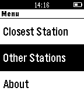

<!-- Generated by scripts/update_app_directory.py: do not edit by hand -->
[← All Pebble Developers](../developers.md)

# Gaarathu

*1 app · Last updated 2026-10-12 · [About these lists](../about-app-lists.md)*

Links: [Pebble App Store](https://apps.repebble.com/apps/dev/gaarathu_5443d83233c9c090c20000c1) · [GitHub (sammanthp007)](https://github.com/sammanthp007)

<h2 class="app-name" id="app-54ffe7a20bde9aff230000ef"><a href="https://apps.repebble.com/54ffe7a20bde9aff230000ef">Metro DC</a> v1.0</h2>
<a class="app-source" href="https://github.com/sammanthp007/HUhack" title="Source code" data-search-exclude>View source</a>

App

Released 2015-03-11 Updated 2015-03-11

Runs on: Time 2, Pebble 2 Duo, Pebble 2, Time, Classic

Locates the nearest metro near you anywhere in Washington, DC.

