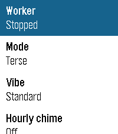

<!-- Generated by scripts/update_app_directory.py: do not edit by hand -->
[← All Pebble Developers](../developers.md)

# Gabriel Krieshok

*1 app · Last updated 2026-10-11 · [About these lists](../about-app-lists.md)*

Links: [Rebble App Store](https://apps.rebble.io/en_US/developer/6ac92e62e724800008db2fc5/1) · [GitHub (gabrielkrieshok)](https://github.com/gabrielkrieshok) · [Website (gabrielkrieshok.com)](https://gabrielkrieshok.com)

<h2 class="app-name" id="app-6ac931717c7c2000098af597"><a href="https://apps.rebble.io/en_US/application/6ac931717c7c2000098af597">Pulse Time</a> v1.2.2</h2>
<a class="app-source" href="https://github.com/gabrielkrieshok/pulse-time" title="Source code" data-search-exclude>View source</a>

App · <a href="https://forum.rebble.io/t/1417" title="Discuss this app on the Rebble forum" data-search-exclude>Forum thread</a>

Released 2026-10-09 Updated 2026-10-09 Rebble App Store

Runs on: Round 2, Time 2, Pebble 2 Duo, Pebble 2, Time Round, Time, Classic

Feel the time on your wrist instead of looking at it. Triple-tap your wrist and Pulse Time vibrates the current time in long and short pulses. It works in meetings, in the dark, and while your…

