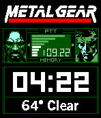
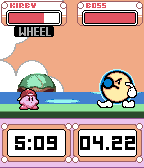
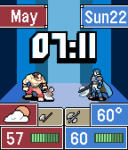
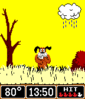
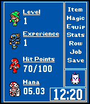
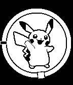

<!-- Generated by scripts/update_app_directory.py: do not edit by hand -->
[← All Pebble Developers](../developers.md)

# Game Time

*6 watchfaces · Last updated 2026-10-11 · [About these lists](../about-app-lists.md)*

Links: [Pebble App Store](https://apps.repebble.com/apps/dev/game-time_53b317a44f927e319f0000ae) · [GitHub (WinterWinter)](https://github.com/WinterWinter) · [Website (facebook.com)](https://www.facebook.com/gametimewatches)

<button type="button" data-filter="all" aria-pressed="true">All 6</button><button type="button" data-filter="watchface" aria-pressed="false">Watchfaces 6</button><button type="button" data-filter="watchapp" aria-pressed="false" disabled>Apps 0</button>

<label class="dev-sort">Sort by <select><option value="updated">Recently updated</option><option value="released">Newest release</option><option value="title">A–Z</option></select></label>

<h2 class="app-name" id="app-549a3101a0bb06472700003e"><a href="https://apps.repebble.com/549a3101a0bb06472700003e">Metal Gear GT</a> v3.4</h2>
<a class="app-source" href="https://github.com/WinterWinter/metalgearpebble" title="Source code" data-search-exclude>View source</a>

Watchface

No licence Released 2014-12-24 Updated 2016-09-22

Runs on: Time 2, Pebble 2 Duo, Pebble 2, Time, Classic

Based off the Gameboy classic Metal Gear: Ghost Babel Features Include: -Bluetooth connection notification. -Random character portraits each hour. -Battery life simulated by the codec signal…

<h2 class="app-name" id="app-571abdc769f1bd2fac000013"><a href="https://apps.repebble.com/571abdc769f1bd2fac000013">Kirby GT</a> v1.2</h2>
<a class="app-source" href="https://github.com/WinterWinter/KirbyGT" title="Source code" data-search-exclude>View source</a>

Watchface

No licence Released 2016-04-23 Updated 2016-06-10

Runs on: Round 2, Time 2, Time Round, Time

The pink ball of fun has made it to the Pebble smartwatch! Based on the GBA title Kirby Nightmare in Dreamland. Features --Animated Kirby-- 6 Animations, Randomly selected and plays each hour…

<h2 class="app-name" id="app-574245e63545cd77f500001f"><a href="https://apps.repebble.com/574245e63545cd77f500001f">Fire Emblem GT</a> v1.1</h2>
<a class="app-source" href="https://github.com/WinterWinter/FEGT" title="Source code" data-search-exclude>View source</a>

Watchface

No licence Released 2016-05-22 Updated 2016-06-10

Runs on: Time 2, Time

Welcome to Fire Emblem GT! Based on Fire Emblem for the Gameboy Advance. Features: Animated Heroes - Choose between Eliwood, Lyn, and Hector and enjoy their critical hit animation each hour…

<h2 class="app-name" id="app-55a8091fcf03f5d59e00004e"><a href="https://apps.repebble.com/55a8091fcf03f5d59e00004e">Duck Hunt GT</a> v1.5</h2>
<a class="app-source" href="https://github.com/WinterWinter/DuckHunt" title="Source code" data-search-exclude>View source</a>

Watchface

No licence Released 2015-07-16 Updated 2016-06-10

Runs on: Time 2, Time

Introducing Duck Hunt GT! Features include -Temperature (requires free API Key from Openweathermap.org) -Weather condition icons -Bluetooth Disconnection Indicator -Randomized characters each hour…

<h2 class="app-name" id="app-54d81627514b48833b000022"><a href="https://apps.repebble.com/54d81627514b48833b000022">Final Fantasy GT</a> v1.7</h2>
<a class="app-source" href="https://github.com/WinterWinter/finalfantasypebble" title="Source code" data-search-exclude>View source</a>

Watchface

No licence Released 2015-02-09 Updated 2016-04-27

Runs on: Round 2, Time 2, Pebble 2 Duo, Pebble 2, Time Round, Time, Classic

Based off the Nintendo classic Final Fantasy 3. Features include: -Heroes- Choose what heroes you&#x27;d like to adventure with. -Levels- Levels are gained based on the difficulty mode you choose. Easy…

<h2 class="app-name" id="app-552efb7f96029b71a7000075"><a href="https://apps.repebble.com/552efb7f96029b71a7000075">Pokemon GT</a> v1.6</h2>
<a class="app-source" href="https://github.com/WinterWinter/pokemonpebble" title="Source code" data-search-exclude>View source</a>

Watchface

No licence Released 2015-04-15 Updated 2015-05-30

Runs on: Time 2, Pebble 2 Duo, Pebble 2, Time, Classic

Enjoy your choice of a large variety of Pokemon including Squirtle, Bulbsaur, Charmander, Pikachu and much more! Features include: Digital Time (with option to remove analog hands) Random Pokemon…

