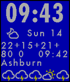

<!-- Generated by scripts/update_app_directory.py: do not edit by hand -->
[← All Pebble Developers](../developers.md)

# Gary Sleet

*1 watchface · Last updated 2026-10-11 · [About these lists](../about-app-lists.md)*

Links: [Pebble App Store](https://apps.repebble.com/apps/dev/gary-sleet_52f143208d40befc3a000105) · [GitHub (garysleet)](https://github.com/garysleet)

<h2 class="app-name" id="app-556d94d2ab161f3ce10000bc"><a href="https://apps.repebble.com/556d94d2ab161f3ce10000bc">futura-gary</a> v3.4</h2>
<a class="app-source" href="https://github.com/garysleet/futura-gary" title="Source code" data-search-exclude>View source</a>

Watchface

Released 2015-06-02 Updated 2015-06-17

Runs on: Time 2, Pebble 2 Duo, Pebble 2, Time, Classic

Crammed as much information as I could onto the watch face, and added many power management features. The weather symbol next to the date is the current conditions. The 5 symbols along the bottom…

