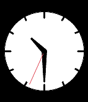

<!-- Generated by scripts/update_app_directory.py: do not edit by hand -->
[← All Pebble Developers](../developers.md)

# GautamG

*1 watchface · Last updated 2026-10-11 · [About these lists](../about-app-lists.md)*

Links: [Rebble App Store](https://apps.rebble.io/en_US/developer/67a9932faf65e00007580b90/1) · [GitHub (Gautam3767)](https://github.com/Gautam3767)

<h2 class="app-name" id="app-67c53a04b7a02300092ba0a5"><a href="https://apps.rebble.io/en_US/application/67c53a04b7a02300092ba0a5">Simple_Analog</a> v1.0</h2>
<a class="app-source" href="https://github.com/Gautam3767/pebble_simple_analog" title="Source code" data-search-exclude>View source</a>

Watchface

No licence Released 2025-03-03 Updated 2025-03-03 Rebble App Store

Runs on: Round 2, Time 2, Pebble 2 Duo, Pebble 2, Time Round, Time, Classic

Its a simple analog watch face to view time

