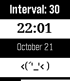

<!-- Generated by scripts/update_app_directory.py: do not edit by hand -->
[← All Pebble Developers](../developers.md)

# Gavin Zhang

*1 app · Last updated 2026-10-12 · [About these lists](../about-app-lists.md)*

Links: [Pebble App Store](https://apps.repebble.com/apps/dev/gavin-zhang_5442ab2588962c13a20000f1) · [GitHub (gavinz0228)](https://github.com/gavinz0228)

<h2 class="app-name" id="app-544788d2ca36fba9ec00003d"><a href="https://apps.repebble.com/544788d2ca36fba9ec00003d">Wake Me Up</a> v1.0</h2>
<a class="app-source" href="https://github.com/gavinz0228/WakeUp-pebble-watchapp" title="Source code" data-search-exclude>View source</a>

App

No licence Released 2014-10-22 Updated 2014-10-23

Runs on: Time 2, Pebble 2 Duo, Pebble 2, Time, Classic

It&#x27;s an app that can wake you up by its vibration. The interval of its vibration can be customized. By clicking &#x27;UP&#x27; or ‘Down’, you can adjust the vibrating interval, and you can press the…

