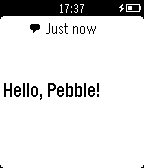

<!-- Generated by scripts/update_app_directory.py: do not edit by hand -->
[← All Pebble Developers](../developers.md)

# GClue, Inc.

*1 app · Last updated 2026-10-11 · [About these lists](../about-app-lists.md)*

Links: [Pebble App Store](https://apps.repebble.com/apps/dev/gclue-inc_5475831d73fafe48db00002f) · [GitHub (DeviceConnect)](https://github.com/DeviceConnect) · [Website (gclue.io)](http://www.gclue.io/dwa/)

<h2 class="app-name" id="app-5475839405bfc8de88000027"><a href="https://apps.repebble.com/5475839405bfc8de88000027">Device WebAPI App</a> v1.3</h2>
<a class="app-source" href="https://github.com/DeviceConnect" title="Source code" data-search-exclude>View source</a>

App

Released 2014-11-26 Updated 2017-12-07

Runs on: Time 2, Pebble 2 Duo, Pebble 2, Time, Classic

This app is need to communicate between Pebble and the web app running on DeviceWebAPIBrowser or DeviceWebAPI Manager. The web app requests &quot;Device WebAPI App&quot; to: - Provide Pebble&#x27;s battery…

