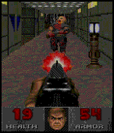
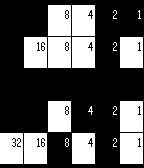

<!-- Generated by scripts/update_app_directory.py: do not edit by hand -->
[← All Pebble Developers](../developers.md)

# GeekyPanda

*2 watchfaces · Last updated 2026-10-11 · [About these lists](../about-app-lists.md)*

Links: [Pebble App Store](https://apps.repebble.com/apps/dev/geekypanda_52c0f47dcf53857c89000034) · [Rebble App Store](https://apps.rebble.io/en_US/developer/52c0f47dcf53857c89000034/1) · [GitHub (PJayB)](https://github.com/PJayB) · [Website (pjblewis.com)](http://pjblewis.com/)

<button type="button" data-filter="all" aria-pressed="true">All 2</button><button type="button" data-filter="watchface" aria-pressed="false">Watchfaces 2</button><button type="button" data-filter="watchapp" aria-pressed="false" disabled>Apps 0</button>

<label class="dev-sort">Sort by <select><option value="updated">Recently updated</option><option value="released">Newest release</option><option value="title">A–Z</option></select></label>

<h2 class="app-name" id="app-5608a39ebcd03b90b2000018"><a href="https://apps.repebble.com/5608a39ebcd03b90b2000018">DOOM 2</a> v4.0</h2>
<a class="app-source" href="https://github.com/PJayB/PebbleDoom2/" title="Source code" data-search-exclude>View source</a>

Watchface

No licence Released 2015-09-28 Updated 2015-10-26

Runs on: Time 2, Time

DOOM 2 watchface with battery indicator and bluetooth connection status light. Every minute, Doomguy will blow the zombie away. Tap your Pebble to fire manually! As your Pebble&#x27;s battery runs…

<h2 class="app-name" id="app-52c0ff5c2be6d8ecad000034"><a href="https://apps.rebble.io/en_US/application/52c0ff5c2be6d8ecad000034">0x539</a> v1.0</h2>
<a class="app-source" href="https://github.com/PJayB/0x539_watch_face" title="Source code" data-search-exclude>View source</a>

Watchface

No licence Released 2013-12-30 Updated 2014-05-10 Rebble App Store

Runs on: Time 2, Pebble 2 Duo, Pebble 2, Time, Classic

Binary watch with Month/Day and Hour/Minute.

