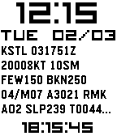

<!-- Generated by scripts/update_app_directory.py: do not edit by hand -->
[← All Pebble Developers](../developers.md)

# Geoffrey Gallaway

*1 watchface · Last updated 2026-10-12 · [About these lists](../about-app-lists.md)*

Links: [Pebble App Store](https://apps.repebble.com/apps/dev/geoffrey-gallaway_52f3e35840e790d9fd000091) · [GitHub (geoffeg)](https://github.com/geoffeg) · [Website (av-wx.com)](http://av-wx.com)

<h2 class="app-name" id="app-5498cf1173268f42dd000048"><a href="https://apps.repebble.com/5498cf1173268f42dd000048">av-wx</a> v1.1</h2>
<a class="app-source" href="https://github.com/geoffeg/PebblePilotTz" title="Source code" data-search-exclude>View source</a>

Watchface

No licence Released 2014-12-23 Updated 2015-02-03

Runs on: Time 2, Pebble 2 Duo, Pebble 2, Time, Classic

Weather for pilots! Shows local time and date, METAR of closest airport (US only) and zulu time.

