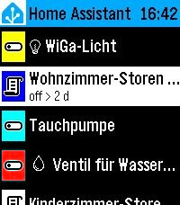

<!-- Generated by scripts/update_app_directory.py: do not edit by hand -->
[← All Pebble Developers](../developers.md)

# George Ruinelli

*1 watchface and 2 apps · Last updated 2026-10-11 · [About these lists](../about-app-lists.md)*

Links: [Pebble App Store](https://apps.repebble.com/apps/dev/george-ruinelli_52c9626e6025fc7211000054) · [GitHub (caco3)](https://github.com/caco3)

<button type="button" data-filter="all" aria-pressed="true">All 3</button><button type="button" data-filter="watchface" aria-pressed="false">Watchfaces 1</button><button type="button" data-filter="watchapp" aria-pressed="false">Apps 2</button>

<label class="dev-sort">Sort by <select><option value="updated">Recently updated</option><option value="released">Newest release</option><option value="title">A–Z</option></select></label>

<h2 class="app-name" id="app-9a8d925ad40f4d6e9d436726"><a href="https://apps.repebble.com/9a8d925ad40f4d6e9d436726">Home Assistant on your Wrist</a> v1.3</h2>
<a class="app-source" href="https://github.com/caco3/pebble-home-assistant-on-your-wrist" title="Source code" data-search-exclude>View source</a>

App · <a href="https://forum.rebble.io/t/1232" title="Discuss this app on the Rebble forum" data-search-exclude>Forum thread</a>

MIT Released 2026-08-14 Updated 2026-09-11

Runs on: Time 2

Easy access to your Home Assistant instance This is a fork of &quot;Home Assistant WS&quot; but enhanced with many new features: - Easy Favorites Pinning - Edit the favorites directly on the smart phone …

<h2 class="app-name" id="app-ff9fb51545554a3197d047c4"><a href="https://apps.repebble.com/ff9fb51545554a3197d047c4">TimeStyle with battery reporting</a> v7.11.5</h2>
<a class="app-source" href="https://github.com/caco3/TimeStylePebble" title="Source code" data-search-exclude>View source</a>

Watchface

MIT Released 2026-06-16 Updated 2026-06-16

Runs on: Round 2, Time 2, Pebble 2 Duo, Pebble 2, Time Round, Time, Classic

TimeStylePebble with battery reporting. This is based on https://apps.rebble.io/en_US/application/55a5c024f4510f794c000071 but extended with battery reporting to a webhook

<h2 class="app-name" id="app-6a97d5588db846359d7fb84b"><a href="https://apps.repebble.com/6a97d5588db846359d7fb84b">Navigation / Geocaching for Pebble</a> v2.0.1</h2>
<a class="app-source" href="https://github.com/caco3/pebble-navigation" title="Source code" data-search-exclude>View source</a>

App

Apache-2.0 Released 2026-05-19 Updated 2026-05-19

Runs on: Round 2, Time 2, Pebble 2 Duo, Pebble 2, Time Round, Time, Classic

This app shows you distance and direction to the navigation point or geocache on your pebble! It supports Pebble compass! It is based on…

