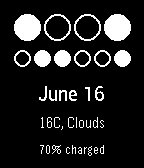

<!-- Generated by scripts/update_app_directory.py: do not edit by hand -->
[← All Pebble Developers](../developers.md)

# Geraint White

*2 watchfaces · Last updated 2026-10-11 · [About these lists](../about-app-lists.md)*

Links: [Pebble App Store](https://apps.repebble.com/apps/dev/geraint-white_549bf174054472596700023a) · [GitHub (grit96)](https://github.com/grit96)

<button type="button" data-filter="all" aria-pressed="true">All 2</button><button type="button" data-filter="watchface" aria-pressed="false">Watchfaces 2</button><button type="button" data-filter="watchapp" aria-pressed="false" disabled>Apps 0</button>

<label class="dev-sort">Sort by <select><option value="updated">Recently updated</option><option value="released">Newest release</option><option value="title">A–Z</option></select></label>

<h2 class="app-name" id="app-55ef051aaab2f909b9000021"><a href="https://apps.repebble.com/55ef051aaab2f909b9000021">Arc Watchface</a> v1.4</h2>
<a class="app-source" href="https://github.com/grit96/ArcWatchface" title="Source code" data-search-exclude>View source</a>

Watchface

Released 2015-09-08 Updated 2025-12-01

Runs on: Time 2, Pebble 2 Duo, Pebble 2, Time, Classic

Arc watchface with arcs for hours (inner) and minutes (outer). Has battery percentage in the middle and date below. Colours can be inverted and battery percentage and date visibility can be…

<h2 class="app-name" id="app-557dc881a404af9b65000051"><a href="https://apps.repebble.com/557dc881a404af9b65000051">Binary Watch</a> v1.4</h2>
<a class="app-source" href="https://github.com/grit96/pebble-binary" title="Source code" data-search-exclude>View source</a>

Watchface

Released 2015-06-14 Updated 2016-07-30

Runs on: Time 2, Pebble 2 Duo, Pebble 2, Time, Classic

Binary watchface. Top line of bits for the hour (4 bits for 12 hour or 5 bits for 24 hour). Bottom line of bits for the minutes. LSB is the rightmost bit. Additional date and weather information…

