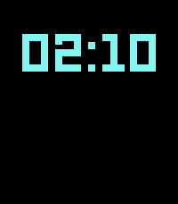

<!-- Generated by scripts/update_app_directory.py: do not edit by hand -->
[← All Pebble Developers](../developers.md)

# gerbert

*1 watchface · Last updated 2026-10-12 · [About these lists](../about-app-lists.md)*

Links: [Pebble App Store](https://apps.repebble.com/apps/dev/gerbert_448ca3d91c5aed37ba166e4c) · [GitHub (gerbert)](https://github.com/gerbert)

<h2 class="app-name" id="app-30b3c97f46be4699859706c0"><a href="https://apps.repebble.com/30b3c97f46be4699859706c0">//GRID</a> v2.7.3</h2>
<a class="app-source" href="https://github.com/gerbert/grid" title="Source code" data-search-exclude>View source</a>

Watchface

GPL-2.0 Released 2026-04-04 Updated 2026-09-08

Runs on: Time 2, Pebble 2 Duo

//GRID is a minimalist watchface for Pebble Time 2 and Pebble 2 Duo, inspired by the visual language of the TRON universe - a black background, neon geometry, scanline details, and LCD-style…

