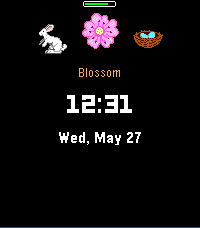

<!-- Generated by scripts/update_app_directory.py: do not edit by hand -->
[← All Pebble Developers](../developers.md)

# Gergely Polonkai

*1 watchface · Last updated 2026-10-12 · [About these lists](../about-app-lists.md)*

Links: [Pebble App Store](https://apps.repebble.com/apps/dev/gergely-polonkai_a5e2a842b1973e6b17a8fc21)

<h2 class="app-name" id="app-90864dbd74a34d2890e11e99"><a href="https://apps.repebble.com/90864dbd74a34d2890e11e99">Seasonal Hours Clock</a> v0.3.0</h2>
<a class="app-source" href="https://gitea.polonkai.eu/gergely/pebble-seasonal-clock" title="Source code" data-search-exclude>View source</a>

Watchface

Released 2026-05-27 Updated 2026-06-19

Runs on: Round 2, Time 2, Pebble 2 Duo, Pebble 2, Time Round, Time, Classic

Watchface to display the Seasonal Hours (https://seasonalclock.org/)

