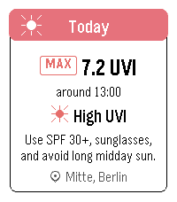

<!-- Generated by scripts/update_app_directory.py: do not edit by hand -->
[← All Pebble Developers](../developers.md)

# ggogel

*1 app · Last updated 2026-10-11 · [About these lists](../about-app-lists.md)*

Links: [Pebble App Store](https://apps.repebble.com/apps/dev/ggogel_002394681bf3f1258a2de4b8) · [GitHub (ggogel)](https://github.com/ggogel)

<h2 class="app-name" id="app-ce83e3b7c2f4491991a5fc19"><a href="https://apps.repebble.com/ce83e3b7c2f4491991a5fc19">UV Guard</a> v1.0.1</h2>
<a class="app-source" href="https://github.com/ggogel/pebble-uv-guard" title="Source code" data-search-exclude>View source</a>

App

Released 2026-07-01 Updated 2026-07-03

Runs on: Round 2, Time 2, Pebble 2 Duo, Pebble 2, Time Round, Time, Classic

UV Guard helps you know when the sun is worth taking seriously. Get a quick, glanceable UV forecast on your Pebble with the information that actually matters: how strong UV will get, when it…

