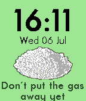
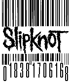

<!-- Generated by scripts/update_app_directory.py: do not edit by hand -->
[← All Pebble Developers](../developers.md)

# Gia90

*2 watchfaces · Last updated 2026-10-12 · [About these lists](../about-app-lists.md)*

Links: [Pebble App Store](https://apps.repebble.com/apps/dev/gia90_55fc62f9defa9ed2da000095) · [GitHub (Gia90)](https://github.com/Gia90)

<button type="button" data-filter="all" aria-pressed="true">All 2</button><button type="button" data-filter="watchface" aria-pressed="false">Watchfaces 2</button><button type="button" data-filter="watchapp" aria-pressed="false" disabled>Apps 0</button>

<label class="dev-sort">Sort by <select><option value="updated">Recently updated</option><option value="released">Newest release</option><option value="title">A–Z</option></select></label>

<h2 class="app-name" id="app-577d109366202abaab0001eb"><a href="https://apps.repebble.com/577d109366202abaab0001eb">UTOPIA</a> v1.0</h2>
<a class="app-source" href="https://github.com/Gia90/PebbleUtopia" title="Source code" data-search-exclude>View source</a>

Watchface

Other Released 2016-07-06 Updated 2016-07-06

Runs on: Time 2, Time

UTOPIA Pebble watchface, inspired by UTOPIA TV Show. Main features: - Cool battery indicator (Chilly: 100-80%, Sand: 70-50%, Bleach: 40-30%, Spoon: 20-10%, Eye: 0%) - Customizable colors (Presets…

<h2 class="app-name" id="app-576429bb2946d7b5e30000ae"><a href="https://apps.repebble.com/576429bb2946d7b5e30000ae">Slipknot Barcode</a> v2.0</h2>
<a class="app-source" href="https://github.com/Gia90/PebbleSlipknotBarcode" title="Source code" data-search-exclude>View source</a>

Watchface

Other Released 2016-06-17 Updated 2016-06-22

Runs on: Time 2, Pebble 2 Duo, Pebble 2, Time, Classic

Simple Slipknot Barcode Pebble Watchface, with time, date, battery and steps. Lower left corner digit: step count (thousands) Left 4-digit group: time Right 6-digits group: date (dd MM yy) Lower…

