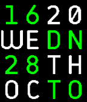
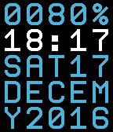

<!-- Generated by scripts/update_app_directory.py: do not edit by hand -->
[← All Pebble Developers](../developers.md)

# Gianluca Troiani

*2 watchfaces · Last updated 2026-10-11 · [About these lists](../about-app-lists.md)*

Links: [Pebble App Store](https://apps.repebble.com/apps/dev/gianluca-troiani_56162132ef230bb954000073) · [Rebble App Store](https://apps.rebble.io/en_US/developer/56162132ef230bb954000073/1) · [GitHub (giatro)](https://github.com/giatro)

<button type="button" data-filter="all" aria-pressed="true">All 2</button><button type="button" data-filter="watchface" aria-pressed="false">Watchfaces 2</button><button type="button" data-filter="watchapp" aria-pressed="false" disabled>Apps 0</button>

<label class="dev-sort">Sort by <select><option value="updated">Recently updated</option><option value="released">Newest release</option><option value="title">A–Z</option></select></label>

<h2 class="app-name" id="app-5630dfd19c667e7a78000051"><a href="https://apps.repebble.com/5630dfd19c667e7a78000051">Grid Color</a> v2.0</h2>
<a class="app-source" href="https://github.com/giatro/Grid-Color" title="Source code" data-search-exclude>View source</a>

Watchface

Released 2015-10-28 Updated 2025-11-25

Runs on: Time 2, Time

A colourful and customizable watchface based on Grid Lite, now with BT connection monitor.

<h2 class="app-name" id="app-585572685de850e8dc00017c"><a href="https://apps.rebble.io/en_US/application/585572685de850e8dc00017c">25 o&#x27;clock</a> v1.1</h2>
<a class="app-source" href="https://github.com/giatro/25OCLOCK" title="Source code" data-search-exclude>View source</a>

Watchface

Released 2016-12-17 Updated 2025-11-25 Rebble App Store

Runs on: Time 2, Pebble 2 Duo, Pebble 2, Time, Classic

5x5 text grid watchface. You can set function for each line from: - Time (12:34) - Day date (SUN01) - Month date (DEC01) - Month (DECEM) - Year (Y2016) - Battery - Steps You can set font and…

