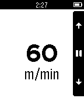

<!-- Generated by scripts/update_app_directory.py: do not edit by hand -->
[← All Pebble Developers](../developers.md)

# Gianpaulo M. Soares

*1 app · Last updated 2026-10-11 · [About these lists](../about-app-lists.md)*

Links: [Pebble App Store](https://apps.repebble.com/apps/dev/gianpaulo-m-soares_54f6629fe8b907ee750000cc) · [GitHub (jampow)](https://github.com/jampow)

<h2 class="app-name" id="app-550520f5be287a2e0a000085"><a href="https://apps.repebble.com/550520f5be287a2e0a000085">Velocimeter</a> v1.1</h2>
<a class="app-source" href="https://github.com/jampow/Peb-2-3-4" title="Source code" data-search-exclude>View source</a>

App

Released 2015-03-15 Updated 2015-03-15

Runs on: Time 2, Pebble 2 Duo, Pebble 2, Time, Classic

It&#x27;s just like a metronome by vibrations to regular walks.

