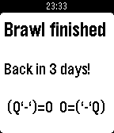

<!-- Generated by scripts/update_app_directory.py: do not edit by hand -->
[← All Pebble Developers](../developers.md)

# gibbage

*1 app · Last updated 2026-10-11 · [About these lists](../about-app-lists.md)*

Links: [Pebble App Store](https://apps.repebble.com/apps/dev/gibbage_53709b2b73825a03f20000c8) · [GitHub (gibbage)](https://github.com/gibbage)

<h2 class="app-name" id="app-56d6ca7d153e89984a00000f"><a href="https://apps.repebble.com/56d6ca7d153e89984a00000f">It&#x27;s Tavern Brawl Time</a> v1.5</h2>
<a class="app-source" href="https://github.com/gibbage/tavern-brawl-time" title="Source code" data-search-exclude>View source</a>

App

Released 2016-03-02 Updated 2016-03-29

Runs on: Time 2, Pebble 2 Duo, Pebble 2, Time, Classic

Sick of opening Hearthstone just to see details of the latest Tavern Brawl? Me too! So why not let your Pebble do the work for you? &quot;It&#x27;s Tavern Brawl Time&quot; is a simple watchapp that displays the…

