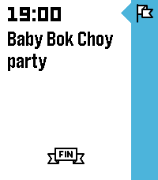
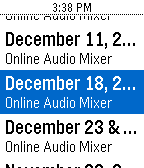

<!-- Generated by scripts/update_app_directory.py: do not edit by hand -->
[← All Pebble Developers](../developers.md)

# gibbiemonster

*2 apps · Last updated 2026-10-12 · [About these lists](../about-app-lists.md)*

Links: [Rebble App Store](https://apps.rebble.io/en_US/developer/5cdc3a87f518e60001e4c071/1) · [GitHub (blockarchitech)](https://github.com/blockarchitech) · [Website (blockarchitech.com)](https://blockarchitech.com)

<button type="button" data-filter="all" aria-pressed="true">All 2</button><button type="button" data-filter="watchface" aria-pressed="false" disabled>Watchfaces 0</button><button type="button" data-filter="watchapp" aria-pressed="false">Apps 2</button>

<label class="dev-sort">Sort by <select><option value="updated">Recently updated</option><option value="released">Newest release</option><option value="title">A–Z</option></select></label>

<h2 class="app-name" id="app-6837b69b7c3a470009af6c56"><a href="https://apps.rebble.io/en_US/application/6837b69b7c3a470009af6c56">TimeToDo</a> v2.0</h2>
<a class="app-source" href="https://github.com/blockarchitech/timetodo" title="Source code" data-search-exclude>View source</a>

App · <a href="https://forum.rebble.io/t/125" title="Discuss this app on the Rebble forum" data-search-exclude>Forum thread</a>

Apache-2.0 Released 2025-05-29 Updated 2025-09-23 Rebble App Store

Runs on: Round 2, Time 2, Pebble 2 Duo, Pebble 2, Time Round, Time, Classic

**This app does not work with the Core Devices mobile app. A Rebble account is required to use TimeToDo.** Sync your Todoist tasks with your timeline! - Syncs your Todoist tasks with due date and…

<h2 class="app-name" id="app-6377f2c7fdf3e30009f63951"><a href="https://apps.rebble.io/en_US/application/6377f2c7fdf3e30009f63951">Services for Pebble</a> v2.1</h2>
<a class="app-source" href="https://github.com/blockarchitech/pebble" title="Source code" data-search-exclude>View source</a>

App

No licence Released 2022-11-18 Updated 2024-04-09 Rebble App Store

Runs on: Round 2, Time 2, Pebble 2 Duo, Pebble 2, Time Round, Time, Classic

Manage your Planning Center Services - on your wrist!

