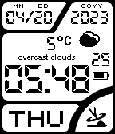

<!-- Generated by scripts/update_app_directory.py: do not edit by hand -->
[← All Pebble Developers](../developers.md)

# Gigahawk

*1 watchface · Last updated 2026-10-11 · [About these lists](../about-app-lists.md)*

Links: [Rebble App Store](https://apps.rebble.io/en_US/developer/55f0e33969efdb7c01000039/1) · [GitHub (Gigahawk)](https://github.com/Gigahawk)

<h2 class="app-name" id="app-6440d3229c7c9300b166555f"><a href="https://apps.rebble.io/en_US/application/6440d3229c7c9300b166555f">Casio-WV-58DE (Gigahawk&#x27;s fork)</a> v2.13</h2>
<a class="app-source" href="https://github.com/Gigahawk/Pebble-Casio-WV58DE" title="Source code" data-search-exclude>View source</a>

Watchface

No licence Released 2023-04-20 Updated 2023-04-20 Rebble App Store

Runs on: Time 2, Pebble 2 Duo, Pebble 2, Time, Classic

Fork of Jack T&#x27;s watchface. Settings page has been updated to use Clay, and a field for a personal OpenWeatherMap API key

