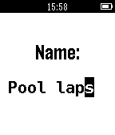

<!-- Generated by scripts/update_app_directory.py: do not edit by hand -->
[← All Pebble Developers](../developers.md)

# GilDev

*1 app · Last updated 2026-10-12 · [About these lists](../about-app-lists.md)*

Links: [Pebble App Store](https://apps.repebble.com/apps/dev/gildev_531b6c608d1b3e5776000467) · [GitHub (GilDev)](https://github.com/GilDev)

<h2 class="app-name" id="app-55747e02f5c314f182000074"><a href="https://apps.repebble.com/55747e02f5c314f182000074">MultiCount</a> v2.1</h2>
<a class="app-source" href="https://github.com/GilDev/MultiCount" title="Source code" data-search-exclude>View source</a>

App

MIT Released 2015-06-07 Updated 2015-07-31

Runs on: Time 2, Pebble 2 Duo, Pebble 2, Time, Classic

Now supports: Français, Deutsch, Espanõl Do you, sometimes, want or need to count things, but just can&#x27;t keep track of everything in your head? MultiCount is what you need! It allows you to manage…

