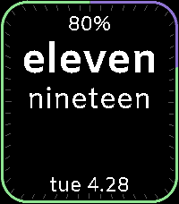
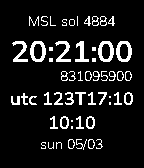

<!-- Generated by scripts/update_app_directory.py: do not edit by hand -->
[← All Pebble Developers](../developers.md)

# Ginko72

*3 watchfaces · Last updated 2026-10-11 · [About these lists](../about-app-lists.md)*

Links: [Pebble App Store](https://apps.repebble.com/apps/dev/ginko72_52d0e60b3364778ac00000c9) · [GitHub (Ginko72)](https://github.com/Ginko72) · [GitHub (stough)](https://github.com/stough)

<button type="button" data-filter="all" aria-pressed="true">All 3</button><button type="button" data-filter="watchface" aria-pressed="false">Watchfaces 3</button><button type="button" data-filter="watchapp" aria-pressed="false" disabled>Apps 0</button>

<label class="dev-sort">Sort by <select><option value="updated">Recently updated</option><option value="released">Newest release</option><option value="title">A–Z</option></select></label>

<h2 class="app-name" id="app-6709f1569dc240d8b4226fb4"><a href="https://apps.repebble.com/6709f1569dc240d8b4226fb4">Simple Text Oh One Steps</a> v1.8.0</h2>
<a class="app-source" href="https://github.com/Ginko72/PebbleTextHealth" title="Source code" data-search-exclude>View source</a>

Watchface

CC0-1.0 Released 2026-04-18 Updated 2026-06-01

Runs on: Round 2, Time 2, Pebble 2 Duo, Pebble 2, Time Round, Time, Classic

This face offers a slight twist on word time in a simple, graphic design. I&#x27;m a bit pedantic about word time and for 1-9 minutes past the hour, the minutes are &quot;oh one&quot;, etc. Also, for the top of…

<h2 class="app-name" id="app-a3168ac04dbd4309a346c6ea"><a href="https://apps.repebble.com/a3168ac04dbd4309a346c6ea">Curiosity Mars Time</a> v0.1</h2>
<a class="app-source" href="https://github.com/Ginko72/PebbleMSLMarsTime" title="Source code" data-search-exclude>View source</a>

Watchface

CC0-1.0 Released 2026-05-04 Updated 2026-05-04

Runs on: Round 2, Time 2, Pebble 2 Duo, Pebble 2, Time Round, Time, Classic

A Pebble watchface displaying Mars Local Mean Solar Time at the Curiosity rover&#x27;s landing site in Gale Crater, along with the spacecraft clock (SCET), UTC day-of-year, and your local time. Seconds…

<h2 class="app-name" id="app-52db4b58e798b9c8c9000347"><a href="https://apps.repebble.com/52db4b58e798b9c8c9000347">TextWatch with Day/Date</a> v3.0</h2>
<a class="app-source" href="https://github.com/stough/PebbleTextWatch" title="Source code" data-search-exclude>View source</a>

Watchface

Released 2014-01-19 Updated 2026-04-20

Runs on: Time 2, Pebble 2 Duo, Pebble 2, Time, Classic

This watch is a modification of the built in Text Watch face to add date information and to correct the time representation for times that have a spoken zero (10:02 as &quot;ten oh two&quot;). Date info…

