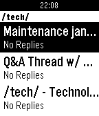
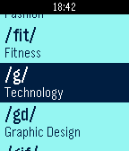

<!-- Generated by scripts/update_app_directory.py: do not edit by hand -->
[← All Pebble Developers](../developers.md)

# Gitgud Software

*2 apps · Last updated 2026-10-11 · [About these lists](../about-app-lists.md)*

Links: [Pebble App Store](https://apps.repebble.com/apps/dev/gitgud-software_54a1e3f00fb15c779f00018e)

<button type="button" data-filter="all" aria-pressed="true">All 2</button><button type="button" data-filter="watchface" aria-pressed="false" disabled>Watchfaces 0</button><button type="button" data-filter="watchapp" aria-pressed="false">Apps 2</button>

<label class="dev-sort">Sort by <select><option value="updated">Recently updated</option><option value="released">Newest release</option><option value="title">A–Z</option></select></label>

<h2 class="app-name" id="app-5695b5bf0065c3cecc000011"><a href="https://apps.repebble.com/5695b5bf0065c3cecc000011">Terminus</a> v1.4</h2>
<a class="app-source" href="https://gitgud.io/gitgud-software/terminus" title="Source code" data-search-exclude>View source</a>

App

Released 2016-01-13 Updated 2016-03-08

Runs on: Round 2, Time 2, Pebble 2 Duo, Pebble 2, Time Round, Time, Classic

Terminus is an endchan browser for Pebble.

<h2 class="app-name" id="app-54c28707f3cb6cf024000064"><a href="https://apps.repebble.com/54c28707f3cb6cf024000064">Trefoil</a> v1.6</h2>
<a class="app-source" href="https://gitgud.io/gitgud-software/trefoil" title="Source code" data-search-exclude>View source</a>

App

Released 2015-01-23 Updated 2016-01-12

Runs on: Round 2, Time 2, Pebble 2 Duo, Pebble 2, Time Round, Time, Classic

Trefoil is an unofficial 4chan browser for Pebble. Now you can check your favorite boards from anywhere, easily and discreetly. Gitgud Software does not generate the content displayed by this app…

