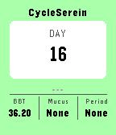

<!-- Generated by scripts/update_app_directory.py: do not edit by hand -->
[← All Pebble Developers](../developers.md)

# github.s2eln

*1 app · Last updated 2026-10-11 · [About these lists](../about-app-lists.md)*

Links: [Pebble App Store](https://apps.repebble.com/apps/dev/github-s2eln_1ca22fc825cde48e75ec7808) · [GitHub (emilepommier)](https://github.com/emilepommier)

<h2 class="app-name" id="app-1d39dcd35839487b8b0bbd4b"><a href="https://apps.repebble.com/1d39dcd35839487b8b0bbd4b">CycleSerein</a> v1.0</h2>
<a class="app-source" href="https://github.com/emilepommier/PebbleCycleSerein" title="Source code" data-search-exclude>View source</a>

App

Released 2026-04-10 Updated 2026-04-10

Runs on: Round 2, Time 2, Pebble 2 Duo, Pebble 2, Time Round, Time, Classic

CyclesSerein is a companion app to track basal body temperature (BBT) for natural family planning. It requires the installation of the main mobile app.

