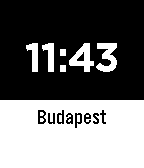

<!-- Generated by scripts/update_app_directory.py: do not edit by hand -->
[← All Pebble Developers](../developers.md)

# GKSoftware

*1 watchface · Last updated 2026-10-11 · [About these lists](../about-app-lists.md)*

Links: [Pebble App Store](https://apps.repebble.com/apps/dev/gksoftware_5527aa8934f01f0092000009) · [GitHub (gklka)](https://github.com/gklka)

<h2 class="app-name" id="app-554f2b304ea974411f00000f"><a href="https://apps.repebble.com/554f2b304ea974411f00000f">Current City</a> v1.01</h2>
<a class="app-source" href="https://github.com/gklka/pebble-currentcity" title="Source code" data-search-exclude>View source</a>

Watchface

Released 2015-05-10 Updated 2015-05-11

Runs on: Time 2, Pebble 2 Duo, Pebble 2, Time, Classic

An easy Pebble smart watch app face, which displays the current city name along the time. Useful if you commute in the night. Features: - 24 hour clock - updates every 15 minutes - updates on…

