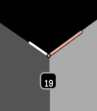
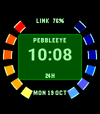

<!-- Generated by scripts/update_app_directory.py: do not edit by hand -->
[← All Pebble Developers](../developers.md)

# gloriousCode

*3 watchfaces · Last updated 2026-10-26 · [About these lists](../about-app-lists.md)*

Links: [Pebble App Store](https://apps.repebble.com/apps/dev/gloriouscode_11cfd2107e16a7ad902f758c) · [GitHub (gloriousCode)](https://github.com/gloriousCode)

<button type="button" data-filter="all" aria-pressed="true">All 3</button><button type="button" data-filter="watchface" aria-pressed="false">Watchfaces 3</button><button type="button" data-filter="watchapp" aria-pressed="false" disabled>Apps 0</button>

<label class="dev-sort">Sort by <select><option value="updated">Recently updated</option><option value="released">Newest release</option><option value="title">A–Z</option></select></label>

<h2 class="app-name" id="app-082418be8cd642a9b06da3ac"><a href="https://apps.repebble.com/082418be8cd642a9b06da3ac">TrioWay</a> v1.3.3</h2>
<a class="app-source" href="https://github.com/gloriousCode/trio-way-watchface" title="Source code" data-search-exclude>View source</a>

Watchface

MIT Released 2026-04-13 Updated 2026-10-23

Runs on: Round 2, Time 2

TrioWay is a watchface for Pebble Time 2 that blends clean geometry with practical time layouts. Features: - Analogue, Digital Small, and Digital Large modes - Three dynamic background sectors…

<h2 class="app-name" id="app-a77242a455c04f94a667dbdf"><a href="https://apps.repebble.com/a77242a455c04f94a667dbdf">Wordish</a> v1.6.4</h2>
<a class="app-source" href="https://github.com/gloriousCode/wordish" title="Source code" data-search-exclude>View source</a>

Watchface

No licence Released 2026-06-12 Updated 2026-10-19

Runs on: Round 2, Time 2, Pebble 2 Duo, Pebble 2, Time Round, Time, Classic

Time in words. Exact when you need it. Wordish gives the classic Pebble word clock crisp text and colourful personalisation. Previously called Fuzzy Text Two. - Read relaxed time at a glance, with…

<h2 class="app-name" id="app-cc5b253a104742bbbbcc2c2e"><a href="https://apps.repebble.com/cc5b253a104742bbbbcc2c2e">PebbleEye</a> v1.6.3</h2>
<a class="app-source" href="https://github.com/gloriousCode/pebbleeye" title="Source code" data-search-exclude>View source</a>

Watchface

No licence Released 2026-07-06 Updated 2026-10-19

Runs on: Round 2, Time 2

Your time. Your mission. Turn your Pebble into a classic spy-watch display. PebbleEye pairs a bold, segmented bezel with a crisp clock and eight coordinated colour palettes: Classic, Amber, Ice…

