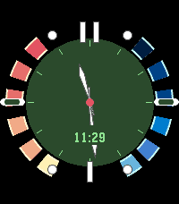
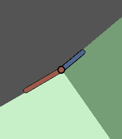

<!-- Generated by scripts/update_app_directory.py: do not edit by hand -->
[← All Pebble Developers](../developers.md)

# gloriousCode

*3 watchfaces · Last updated 2026-10-12 · [About these lists](../about-app-lists.md)*

Links: [Pebble App Store](https://apps.repebble.com/apps/dev/gloriouscode_11cfd2107e16a7ad902f758c) · [GitHub (gloriousCode)](https://github.com/gloriousCode)

<button type="button" data-filter="all" aria-pressed="true">All 3</button><button type="button" data-filter="watchface" aria-pressed="false">Watchfaces 3</button><button type="button" data-filter="watchapp" aria-pressed="false" disabled>Apps 0</button>

<label class="dev-sort">Sort by <select><option value="updated">Recently updated</option><option value="released">Newest release</option><option value="title">A–Z</option></select></label>

<h2 class="app-name" id="app-a77242a455c04f94a667dbdf"><a href="https://apps.repebble.com/a77242a455c04f94a667dbdf">Fuzzy Text Two</a> v1.5.0</h2>
<a class="app-source" href="https://github.com/gloriousCode/fuzzy-text-international-time2" title="Source code" data-search-exclude>View source</a>

Watchface

No licence Released 2026-06-12 Updated 2026-07-09

Runs on: Round 2, Time 2, Pebble 2 Duo, Pebble 2, Time Round, Time, Classic

An updated version of fuzzy text for new watches + colours!

<h2 class="app-name" id="app-cc5b253a104742bbbbcc2c2e"><a href="https://apps.repebble.com/cc5b253a104742bbbbcc2c2e">Goldeneye Time 2</a> v1.5.0</h2>
<a class="app-source" href="https://github.com/gloriousCode/fuzzy-text-two/tree/codex/gabbro-pebbleeye-hud" title="Source code" data-search-exclude>View source</a>

Watchface

No licence Released 2026-07-06 Updated 2026-07-06

Runs on: Round 2, Time 2

GabbroEye HUD is a Pebble watchface branch that recreates the feel of the Nintendo 64-era spy watch interface for modern PebbleOS hardware, with the layout tuned for the 260x260 Gabbro display and…

<h2 class="app-name" id="app-082418be8cd642a9b06da3ac"><a href="https://apps.repebble.com/082418be8cd642a9b06da3ac">TrioWay</a> v1.2</h2>
<a class="app-source" href="https://github.com/gloriousCode/time-2-design" title="Source code" data-search-exclude>View source</a>

Watchface

MIT Released 2026-04-13 Updated 2026-04-14

Runs on: Round 2, Time 2

A playful, retro-modern watch face that uses bold colour-blocked wedges, minimalist hands or numerals, and soft accent tones to make time feel both graphic and fun. Plenty of customisation! …

