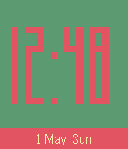

<!-- Generated by scripts/update_app_directory.py: do not edit by hand -->
[← All Pebble Developers](../developers.md)

# gogothegogo

*3 watchfaces · Last updated 2026-10-12 · [About these lists](../about-app-lists.md)*

Links: [Pebble App Store](https://apps.repebble.com/apps/dev/gogothegogo_56e335002526c72e66000023) · [GitHub (gogothegogo)](https://github.com/gogothegogo)

<button type="button" data-filter="all" aria-pressed="true">All 3</button><button type="button" data-filter="watchface" aria-pressed="false">Watchfaces 3</button><button type="button" data-filter="watchapp" aria-pressed="false" disabled>Apps 0</button>

<label class="dev-sort">Sort by <select><option value="updated">Recently updated</option><option value="released">Newest release</option><option value="title">A–Z</option></select></label>

<h2 class="app-name" id="app-573d93ea5253b12407000009"><a href="https://apps.repebble.com/573d93ea5253b12407000009">A Maze</a> v1.0</h2>
<a class="app-source" href="https://github.com/gogothegogo/Maze_Pebble" title="Source code" data-search-exclude>View source</a>

Watchface

No licence Released 2016-05-19 Updated 2016-05-19

Runs on: Time 2, Pebble 2 Duo, Pebble 2, Time, Classic

Cool watchface with maze-like appearance showing time. Shake the watch and you get seconds and date. It is coded to preserve the battery, meaning seconds are not tracked until you shake watch, and…

<h2 class="app-name" id="app-5727b71aded3576963000013"><a href="https://apps.repebble.com/5727b71aded3576963000013">Simple Square</a> v1.0</h2>
<a class="app-source" href="https://github.com/gogothegogo/SimpleSquare_Pebble.git" title="Source code" data-search-exclude>View source</a>

Watchface

No licence Released 2016-05-02 Updated 2016-05-02

Runs on: Time 2, Pebble 2 Duo, Pebble 2, Time, Classic

Simple watchface with square pixel-perfect font with time and date. Completely configurable. You can configure: - time and date font sizes - date on/off - time and date background color …

<h2 class="app-name" id="app-56f9230c61a0160aa700002e"><a href="https://apps.repebble.com/56f9230c61a0160aa700002e">TetrisTime_mod</a> v3.5</h2>
<a class="app-source" href="https://github.com/gogothegogo/TetrisTime" title="Source code" data-search-exclude>View source</a>

Watchface

MIT Released 2016-03-28 Updated 2016-04-02

Runs on: Round 2, Time 2, Pebble 2 Duo, Pebble 2, Time Round, Time, Classic

Completely based on VFLashM amazing TetrisTime watchface. I did few mods for my needs: -got rid of large date fonts -added option of Croatian dates and weekdays -added additional battery empty…

