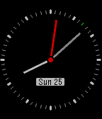

<!-- Generated by scripts/update_app_directory.py: do not edit by hand -->
[← All Pebble Developers](../developers.md)

# Gokmen Goksel

*1 watchface · Last updated 2026-10-12 · [About these lists](../about-app-lists.md)*

Links: [Pebble App Store](https://apps.repebble.com/apps/dev/gokmen-goksel_5596ea5a2205f0de5000007f) · [GitHub (gokmen)](https://github.com/gokmen)

<h2 class="app-name" id="app-562cf0d66edde43084000091"><a href="https://apps.repebble.com/562cf0d66edde43084000091">Istanbul</a> v1.0</h2>
<a class="app-source" href="https://github.com/gokmen/istanbul" title="Source code" data-search-exclude>View source</a>

Watchface

MIT Released 2015-10-25 Updated 2015-10-25

Runs on: Round 2, Time 2, Time Round, Time

Istanbul is a yet simple watch face which is mainly focused on the second hand animation to provide sweeping motion. To prevent battery drain it starts to animate for a minute then returns back to…

