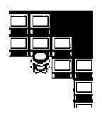

<!-- Generated by scripts/update_app_directory.py: do not edit by hand -->
[← All Pebble Developers](../developers.md)

# Goldkin Drake

*1 app · Last updated 2026-10-12 · [About these lists](../about-app-lists.md)*

Links: [Pebble App Store](https://apps.repebble.com/apps/dev/goldkin-drake_5306878021336cc68f0002ea) · [Website (code.google.com)](https://code.google.com/p/start9)

<h2 class="app-name" id="app-5307a4b88230400fea000153"><a href="https://apps.repebble.com/5307a4b88230400fea000153">start9</a> v0.0.4</h2>
<a class="app-source" href="https://code.google.com/p/start9/source/browse/" title="Source code" data-search-exclude>View source</a>

App

Released 2014-02-21 Updated 2014-02-22

Runs on: Time 2, Pebble 2 Duo, Pebble 2, Time, Classic

Displays the current screen of Twitch Plays Pokemon once a minute. Currently in very early alpha testing. To view the live stream, visit http://www.twitch.tv/twitchplayspokemon This app is neither…

