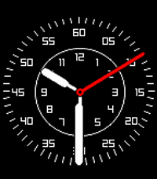
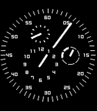
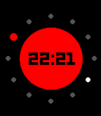

<!-- Generated by scripts/update_app_directory.py: do not edit by hand -->
[← All Pebble Developers](../developers.md)

# Gonzalo Muñoz

*4 watchfaces and 1 app · Last updated 2026-10-11 · [About these lists](../about-app-lists.md)*

Links: [Rebble App Store](https://apps.rebble.io/en_US/developer/609457438a44a400535e6933/1) · [GitHub (zamuz)](https://github.com/zamuz) · [Website (twitter.com)](https://twitter.com/zamuz)

<button type="button" data-filter="all" aria-pressed="true">All 5</button><button type="button" data-filter="watchface" aria-pressed="false">Watchfaces 4</button><button type="button" data-filter="watchapp" aria-pressed="false">Apps 1</button>

<label class="dev-sort">Sort by <select><option value="updated">Recently updated</option><option value="released">Newest release</option><option value="title">A–Z</option></select></label>

<h2 class="app-name" id="app-62ffabcf93b4e8000aa2cbec"><a href="https://apps.rebble.io/en_US/application/62ffabcf93b4e8000aa2cbec">Vuela</a> v1.42</h2>
<a class="app-source" href="https://github.com/zamuz/vuela" title="Source code" data-search-exclude>View source</a>

Watchface

Released 2022-08-19 Updated 2025-08-14 Rebble App Store

Runs on: Round 2, Time 2, Pebble 2 Duo, Pebble 2, Time Round, Time, Classic

A Flieger style watchface.

<h2 class="app-name" id="app-62055185843fe7000aa1c638"><a href="https://apps.rebble.io/en_US/application/62055185843fe7000aa1c638">The Essence</a> v1.81</h2>
<a class="app-source" href="https://github.com/zamuz/the-essence" title="Source code" data-search-exclude>View source</a>

Watchface

Released 2022-02-10 Updated 2025-04-15 Rebble App Store

Runs on: Round 2, Time 2, Pebble 2 Duo, Pebble 2, Time Round, Time, Classic

A watchface based on the Ressence watches, with customizable colors.

<h2 class="app-name" id="app-62d6d52b851e80000b4af1aa"><a href="https://apps.rebble.io/en_US/application/62d6d52b851e80000b4af1aa">Blockslide 3</a> v3.1</h2>
<a class="app-source" href="https://github.com/zamuz/Blockslide-3" title="Source code" data-search-exclude>View source</a>

Watchface

Released 2022-07-19 Updated 2024-08-26 Rebble App Store

Runs on: Round 2, Time 2, Pebble 2 Duo, Pebble 2, Time Round, Time, Classic

A new version of the Blockslide Seconds watchface by Jnm, with a new look and customizable colors.

<h2 class="app-name" id="app-637a906bfdf3e30009f63971"><a href="https://apps.rebble.io/en_US/application/637a906bfdf3e30009f63971">Revolved</a> v1.3</h2>
<a class="app-source" href="https://github.com/zamuz/revolved" title="Source code" data-search-exclude>View source</a>

Watchface

Released 2022-11-20 Updated 2024-01-11 Rebble App Store

Runs on: Round 2, Time 2, Pebble 2 Duo, Pebble 2, Time Round, Time, Classic

An update of the classic Revolver watchface for the Pebble round, now for all Pebbles! Including color and font customization, date display. Release for the Rebble Hackathon #001.

<h2 class="app-name" id="app-64d25223482a0c03a5ab933a"><a href="https://apps.rebble.io/en_US/application/64d25223482a0c03a5ab933a">QuickAuth 4</a> v4.0</h2>
<a class="app-source" href="https://github.com/zamuz/QuickAuth4" title="Source code" data-search-exclude>View source</a>

App

Released 2023-08-08 Updated 2023-08-08 Rebble App Store

Runs on: Round 2, Time 2, Pebble 2 Duo, Pebble 2, Time Round, Time, Classic

A fork of the original QuickAuth app by Kevin Cooper, now with support for SHA256 codes.

