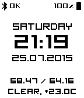
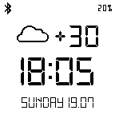

<!-- Generated by scripts/update_app_directory.py: do not edit by hand -->
[← All Pebble Developers](../developers.md)

# GrakovNe

*3 watchfaces · Last updated 2026-10-11 · [About these lists](../about-app-lists.md)*

Links: [Pebble App Store](https://apps.repebble.com/apps/dev/grakovne_553c6ca334add0d82f00002f) · [GitHub (GrakovNe)](https://github.com/GrakovNe) · [Website (grakovne.org)](http://grakovne.org)

<button type="button" data-filter="all" aria-pressed="true">All 3</button><button type="button" data-filter="watchface" aria-pressed="false">Watchfaces 3</button><button type="button" data-filter="watchapp" aria-pressed="false" disabled>Apps 0</button>

<label class="dev-sort">Sort by <select><option value="updated">Recently updated</option><option value="released">Newest release</option><option value="title">A–Z</option></select></label>

<h2 class="app-name" id="app-56a9d7fce3aa86946c00002c"><a href="https://apps.repebble.com/56a9d7fce3aa86946c00002c">SmartFace Timeline</a> v1.5</h2>
<a class="app-source" href="https://github.com/GrakovNe/Pebble_SmartFace_Timeline" title="Source code" data-search-exclude>View source</a>

Watchface

Apache-2.0 Released 2016-01-28 Updated 2016-03-01

Runs on: Round 2, Time 2, Pebble 2 Duo, Pebble 2, Time Round, Time, Classic

New version of stylish, smart and customizable smartface for Pebble! Now, SmartFace fully optimized for Pebble TimeLine and works on Pebble Classic, Steel or Time perfectly! features: - Display…

<h2 class="app-name" id="app-55a41552c12bc1eb71000044"><a href="https://apps.repebble.com/55a41552c12bc1eb71000044">SmartFace</a> v3.5</h2>
<a class="app-source" href="https://github.com/GrakovNe/Pebble-SmartFace" title="Source code" data-search-exclude>View source</a>

Watchface

No licence Released 2015-07-13 Updated 2016-01-12

Runs on: Time 2, Pebble 2 Duo, Pebble 2, Time, Classic

This version of smartface is deprecated! If you want to use this watchface, please, use new version. You can find it in Pebble store as &quot;SmartFace TimeLine&quot; === Functional watchface with a high…

<h2 class="app-name" id="app-55aa9432c380d0b04b00009c"><a href="https://apps.repebble.com/55aa9432c380d0b04b00009c">VIC4884</a> v2.1</h2>
<a class="app-source" href="http://forums.getpebble.com/discussion/10324/javascript-apps-only-allowed-in-official-appstore" title="Source code" data-search-exclude>View source</a>

Watchface

Released 2015-07-18 Updated 2015-07-24

Runs on: Time 2, Pebble 2 Duo, Pebble 2, Time, Classic

Simply watchface special for VIC4884 from 4pda.ru

