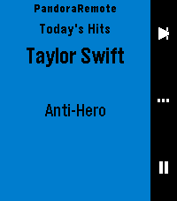
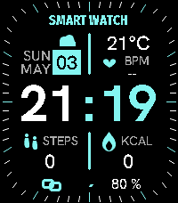

<!-- Generated by scripts/update_app_directory.py: do not edit by hand -->
[← All Pebble Developers](../developers.md)

# gravity\_rose

*1 watchface and 1 app · Last updated 2026-10-12 · [About these lists](../about-app-lists.md)*

Links: [Pebble App Store](https://apps.repebble.com/apps/dev/gravity-rose_a89ac83e4a28a87236ff87f8) · [GitHub (gravity-rose)](https://github.com/gravity-rose)

<button type="button" data-filter="all" aria-pressed="true">All 2</button><button type="button" data-filter="watchface" aria-pressed="false">Watchfaces 1</button><button type="button" data-filter="watchapp" aria-pressed="false">Apps 1</button>

<label class="dev-sort">Sort by <select><option value="updated">Recently updated</option><option value="released">Newest release</option><option value="title">A–Z</option></select></label>

<h2 class="app-name" id="app-78e5649f62a84ec593f49110"><a href="https://apps.repebble.com/78e5649f62a84ec593f49110">Pandora Remote</a> v1.5.2</h2>
<a class="app-source" href="https://github.com/gravity-rose/PandoraRemote" title="Source code" data-search-exclude>View source</a>

App · <a href="https://forum.rebble.io/t/950" title="Discuss this app on the Rebble forum" data-search-exclude>Forum thread</a>

No licence Released 2026-05-04 Updated 2026-05-04

Runs on: Round 2, Time 2, Pebble 2 Duo, Pebble 2, Time Round, Time

Control Pandora from your wrist. PandoraRemote lets you manage playback, rate songs, and adjust volume directly from your Pebble watch. FEATURES - Skip tracks, play/pause with a single button…

<h2 class="app-name" id="app-033a559f19fe4e9eaea7de9f"><a href="https://apps.repebble.com/033a559f19fe4e9eaea7de9f">Bitter Smart Watch</a> v1.0.1</h2>
<a class="app-source" href="https://github.com/gravity-rose/SmartWatch_Replica" title="Source code" data-search-exclude>View source</a>

Watchface · <a href="https://forum.rebble.io/t/951" title="Discuss this app on the Rebble forum" data-search-exclude>Forum thread</a>

No licence Released 2026-05-04 Updated 2026-05-04

Runs on: Time 2

Took a challenge from r/pebble, from BitterCherry6, to replicate a watchface from a photo (to improve my vibecoding skills). This is the result. What you see is what you get, no config, but the…

