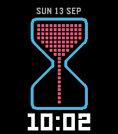
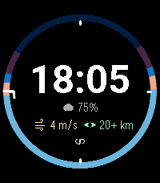

<!-- Generated by scripts/update_app_directory.py: do not edit by hand -->
[← All Pebble Developers](../developers.md)

# Greenteyn

*2 watchfaces · Last updated 2026-10-11 · [About these lists](../about-app-lists.md)*

Links: [Pebble App Store](https://apps.repebble.com/apps/dev/greenteyn_2e30445a303d4cff7ad4c5df) · [GitHub (Greenteyn)](https://github.com/Greenteyn)

<button type="button" data-filter="all" aria-pressed="true">All 2</button><button type="button" data-filter="watchface" aria-pressed="false">Watchfaces 2</button><button type="button" data-filter="watchapp" aria-pressed="false" disabled>Apps 0</button>

<label class="dev-sort">Sort by <select><option value="updated">Recently updated</option><option value="released">Newest release</option><option value="title">A–Z</option></select></label>

<h2 class="app-name" id="app-28e40b7f9f7e43bdb257f421"><a href="https://apps.repebble.com/28e40b7f9f7e43bdb257f421">Pixel Hourglass</a> v1.1.0</h2>
<a class="app-source" href="https://github.com/Greenteyn/pixel-hourglass" title="Source code" data-search-exclude>View source</a>

Watchface

MIT Released 2026-09-24 Updated 2026-09-25

Runs on: Round 2, Time 2

A watchface that shows a stretch of time you choose — from a minute to a whole day — as an hourglass that turns over when it empties. The date sits above the glass, the time in large digits below…

<h2 class="app-name" id="app-be7ddcf0613941d1842c8310"><a href="https://apps.repebble.com/be7ddcf0613941d1842c8310">Alpenglow</a> v1.3.0</h2>
<a class="app-source" href="https://github.com/Greenteyn/alpenglow-watchface" title="Source code" data-search-exclude>View source</a>

Watchface · <a href="https://forum.rebble.io/t/1305" title="Discuss this app on the Rebble forum" data-search-exclude>Forum thread</a>

MIT Released 2026-08-12 Updated 2026-09-25

Runs on: Round 2, Time 2, Pebble 2 Duo, Pebble 2, Time Round, Time

Alpenglow tells you when the light happens. A ring of the day wraps the time and colours every phase by the brightness of the sky: astronomical night, twilight, blue hour, daytime, golden hour. A…

