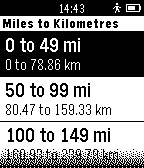
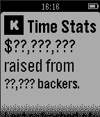

<!-- Generated by scripts/update_app_directory.py: do not edit by hand -->
[← All Pebble Developers](../developers.md)

# Greg Lockwood

*2 apps · Last updated 2026-10-12 · [About these lists](../about-app-lists.md)*

Links: [Pebble App Store](https://apps.repebble.com/apps/dev/greg-lockwood_548443cf9b0ef2e77e000070) · [GitHub (greglockwood)](https://github.com/greglockwood)

<button type="button" data-filter="all" aria-pressed="true">All 2</button><button type="button" data-filter="watchface" aria-pressed="false" disabled>Watchfaces 0</button><button type="button" data-filter="watchapp" aria-pressed="false">Apps 2</button>

<label class="dev-sort">Sort by <select><option value="updated">Recently updated</option><option value="released">Newest release</option><option value="title">A–Z</option></select></label>

<h2 class="app-name" id="app-548902db7d4e8e0a9e000041"><a href="https://apps.repebble.com/548902db7d4e8e0a9e000041">Imperial to Metric Converter</a> v1.4</h2>
<a class="app-source" href="https://github.com/greglockwood/Imp2MetricPebble" title="Source code" data-search-exclude>View source</a>

App

No licence Released 2014-12-11 Updated 2015-04-16

Runs on: Time 2, Pebble 2 Duo, Pebble 2, Time, Classic

Simple imperial to metric conversion app that allows you to quickly convert between units by drilling down in menus until you find a value of sufficient accuracy. So the less precision you…

<h2 class="app-name" id="app-54fe872bdbd96e00fa0000c0"><a href="https://apps.repebble.com/54fe872bdbd96e00fa0000c0">Kickstarter Stats</a> v1.0</h2>
<a class="app-source" href="https://github.com/greglockwood/PebbleTimeKickstarterStats" title="Source code" data-search-exclude>View source</a>

App

No licence Released 2015-03-10 Updated 2015-03-10

Runs on: Time 2, Pebble 2 Duo, Pebble 2, Time, Classic

Display how much money the Pebble guys made with the Pebble Time project on KickStarter. No guarantees are provided that this will continue to work since the project completed funding a while ago…

