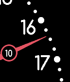
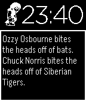

<!-- Generated by scripts/update_app_directory.py: do not edit by hand -->
[← All Pebble Developers](../developers.md)

# Grégoire Sage

*3 watchfaces and 3 apps · Last updated 2026-10-12 · [About these lists](../about-app-lists.md)*

Links: [Pebble App Store](https://apps.repebble.com/apps/dev/gr-goire-sage_52b216cf05c04653a9000080) · [GitHub (gregoiresage)](https://github.com/gregoiresage) · [GitHub (pebble)](https://github.com/pebble) · [Website (paypal.com)](https://www.paypal.com/cgi-bin/webscr?cmd=_donations&business=gregoire%2esage%40gmail%2ecom&lc=US&item_name=NetAtmo%20for%20Pebble&no_note=0&currency_code=USD&bn=PP%2dDonationsBF%3abtn_donateCC_LG%2egif%3aNonHostedGuest)

<button type="button" data-filter="all" aria-pressed="true">All 6</button><button type="button" data-filter="watchface" aria-pressed="false">Watchfaces 3</button><button type="button" data-filter="watchapp" aria-pressed="false">Apps 3</button>

<label class="dev-sort">Sort by <select><option value="updated">Recently updated</option><option value="released">Newest release</option><option value="title">A–Z</option></select></label>

<h2 class="app-name" id="app-5480e782d581a15cd4000088"><a href="https://apps.repebble.com/5480e782d581a15cd4000088">NetAtmo for Pebble</a> v2.2</h2>
<a class="app-source" href="https://github.com/gregoiresage/pebble-netatmo" title="Source code" data-search-exclude>View source</a>

App · <a href="https://forum.rebble.io/t/1330" title="Discuss this app on the Rebble forum" data-search-exclude>Forum thread</a>

No licence Released 2014-12-04 Updated 2026-09-06

Runs on: Time 2, Pebble 2 Duo, Pebble 2, Time, Classic

This watchapp displays data from your NetAtmo® stations. Open the configuration page, enter your credentials and select your default NetAtmo station. The outdoor module is displayed on top. Press…

<h2 class="app-name" id="app-52f2c9ddab54ff806f000088"><a href="https://apps.repebble.com/52f2c9ddab54ff806f000088">Hop Picker Watch</a> v3.16</h2>
<a class="app-source" href="https://github.com/gregoiresage/hop-picker" title="Source code" data-search-exclude>View source</a>

Watchface

GPL-2.0 Released 2014-02-05 Updated 2016-07-04

Runs on: Round 2, Time 2, Pebble 2 Duo, Pebble 2, Time Round, Time, Classic

Configurable watchface based on the concept of the designer Hop Picker Battery grade : A

<h2 class="app-name" id="app-53bdb1291c6da72083000044"><a href="https://apps.repebble.com/53bdb1291c6da72083000044">Image Viewer</a> v2.3</h2>
<a class="app-source" href="https://github.com/gregoiresage/pebble-image-viewer" title="Source code" data-search-exclude>View source</a>

App

No licence Released 2014-07-09 Updated 2015-07-02

Runs on: Time 2, Pebble 2 Duo, Pebble 2, Time, Classic

Proof of Concept Display images from internet on your Pebble Choose your image in the configuration page (jpeg/gif/png or pbi)

<h2 class="app-name" id="app-53ff99c7d08f53676a000043"><a href="https://apps.repebble.com/53ff99c7d08f53676a000043">Pebble Demos</a> v1.3</h2>
<a class="app-source" href="https://github.com/pebble/pebble-sdk-examples" title="Source code" data-search-exclude>View source</a>

App

Released 2014-08-28 Updated 2014-09-21

Runs on: Time 2, Pebble 2 Duo, Pebble 2, Time, Classic

All the Pebble SDK demos in ONE app ! Contains all the watchapps and all the watchfaces

<h2 class="app-name" id="app-53f7ab1a83d82b81b5000237"><a href="https://apps.repebble.com/53f7ab1a83d82b81b5000237">Tiwe</a> v1.0</h2>
<a class="app-source" href="https://github.com/gregoiresage/pebble-tiwe" title="Source code" data-search-exclude>View source</a>

Watchface

No licence Released 2014-08-22 Updated 2014-08-22

Runs on: Time 2, Pebble 2 Duo, Pebble 2, Time, Classic

The watch has tiny white dots around the face. When you twist your wrist, the dots come together to tell you the time. Watchface inspired from TIWE watch concept by chinese product deigner Lv…

<h2 class="app-name" id="app-537924dedf9772aa95000019"><a href="https://apps.repebble.com/537924dedf9772aa95000019">Chuck Norris</a> v0.1.0</h2>
<a class="app-source" href="https://github.com/gregoiresage/pebble-chucknorris" title="Source code" data-search-exclude>View source</a>

Watchface

MIT Released 2014-05-18 Updated 2014-05-22

Runs on: Time 2, Pebble 2 Duo, Pebble 2, Time, Classic

If Chuck Norris wore a watch, it would be a Pebble because it kicks ass! Shake your watch to get a new Chuck Norris joke. Have fun :-p Sprites credits…

