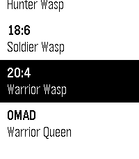

<!-- Generated by scripts/update_app_directory.py: do not edit by hand -->
[← All Pebble Developers](../developers.md)

# gregolsky

*1 app · Last updated 2026-10-12 · [About these lists](../about-app-lists.md)*

Links: [Pebble App Store](https://apps.repebble.com/apps/dev/gregolsky_992b6fe43b5311cf1f6f238f) · [GitHub (gregolsky)](https://github.com/gregolsky) · [Website (gregolsky.pl)](https://gregolsky.pl)

<h2 class="app-name" id="app-396b4d6f5a5643f1bcf8dde0"><a href="https://apps.repebble.com/396b4d6f5a5643f1bcf8dde0">FastWasp</a> v1.9.0</h2>
<a class="app-source" href="https://github.com/gregolsky/fast-wasp-pebble" title="Source code" data-search-exclude>View source</a>

App

No licence Released 2026-06-04 Updated 2026-06-09

Runs on: Time 2, Pebble 2 Duo, Pebble 2, Time

FastWasp is a free, native intermittent-fasting tracker for the new Pebble devices from Core Devices. Everything runs on the watch - no companion app, no phone, no accounts, no internet. 6 fasting…

