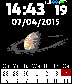
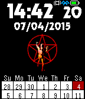
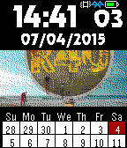
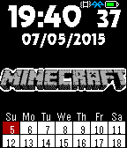
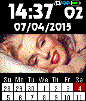
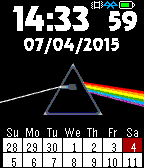
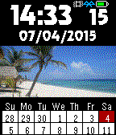

<!-- Generated by scripts/update_app_directory.py: do not edit by hand -->
[← All Pebble Developers](../developers.md)

# Gretchycat

*10 watchfaces · Last updated 2026-10-12 · [About these lists](../about-app-lists.md)*

Links: [Pebble App Store](https://apps.repebble.com/apps/dev/gretchycat_52bf60060136db31fb0000d3) · [GitHub (gretchycat)](https://github.com/gretchycat) · [Website (ipocketcast.com)](http://www.ipocketcast.com/wiki/index.php?title=DarkSide)

<button type="button" data-filter="all" aria-pressed="true">All 10</button><button type="button" data-filter="watchface" aria-pressed="false">Watchfaces 10</button><button type="button" data-filter="watchapp" aria-pressed="false" disabled>Apps 0</button>

<label class="dev-sort">Sort by <select><option value="updated">Recently updated</option><option value="released">Newest release</option><option value="title">A–Z</option></select></label>

<h2 class="app-name" id="app-5527e95fe0d8434b4a000032"><a href="https://apps.repebble.com/5527e95fe0d8434b4a000032">Thetis Moon</a> v3.0</h2>
<a class="app-source" href="https://github.com/gretchycat/DarkSide" title="Source code" data-search-exclude>View source</a>

Watchface

No licence Released 2015-04-10 Updated 2015-10-19

Runs on: Time 2, Pebble 2 Duo, Pebble 2, Time, Classic

A watchface with the Thetis Moon image from Digital Blasphemy Features a 2 week calendar, and when you shake or tap, see a 5 day weather forecast. Tap again for sunrise, sunset and moon phase. Tap…

<h2 class="app-name" id="app-552825b8d59149cca6000064"><a href="https://apps.repebble.com/552825b8d59149cca6000064">The Endless River</a> v3.0</h2>
<a class="app-source" href="https://github.com/gretchycat/DarkSide" title="Source code" data-search-exclude>View source</a>

Watchface

No licence Released 2015-04-10 Updated 2015-10-19

Runs on: Time 2, Pebble 2 Duo, Pebble 2, Time, Classic

The Endless River cover art by Pink Floyd Features a 2 week calendar, and when you shake or tap, see a 5 day weather forecast. Tap again for sunrise, sunset and moon phase. Tap a third time for a…

<h2 class="app-name" id="app-557395787d6f3d41a00000d6"><a href="https://apps.repebble.com/557395787d6f3d41a00000d6">Saturn</a> v3.0</h2>
<a class="app-source" href="https://github.com/gretchycat/DarkSide" title="Source code" data-search-exclude>View source</a>

Watchface

No licence Released 2015-06-07 Updated 2015-10-19

Runs on: Time 2, Pebble 2 Duo, Pebble 2, Time, Classic

Featuring the magnificence of our 6th planet, Saturn! Features a 2 week calendar, and when you shake or tap, see a 5 day weather forecast. Tap again for sunrise, sunset and moon phase. Tap a third…

<h2 class="app-name" id="app-5526f8c31c36ea7cc2000086"><a href="https://apps.repebble.com/5526f8c31c36ea7cc2000086">Rush Starman</a> v3.0</h2>
<a class="app-source" href="https://github.com/gretchycat/DarkSide" title="Source code" data-search-exclude>View source</a>

Watchface

No licence Released 2015-04-09 Updated 2015-10-19

Runs on: Time 2, Pebble 2 Duo, Pebble 2, Time, Classic

A great watchface featuring the Rush StarMan from 2112 Features a 2 week calendar, and when you shake or tap, see a 5 day weather forecast. Tap again for sunrise, sunset and moon phase. Tap a…

<h2 class="app-name" id="app-55832b4a5160206007000008"><a href="https://apps.repebble.com/55832b4a5160206007000008">Rush R40</a> v3.0</h2>
<a class="app-source" href="https://github.com/gretchycat/DarkSide" title="Source code" data-search-exclude>View source</a>

Watchface

No licence Released 2015-06-18 Updated 2015-10-19

Runs on: Time 2, Pebble 2 Duo, Pebble 2, Time, Classic

Rush R40 watchface! Features a 2 week calendar, and when you shake or tap, see a 5 day weather forecast. Tap again for sunrise, sunset and moon phase. Tap a third time for a compass! After 15…

<h2 class="app-name" id="app-5599dec9e47bb350f4000081"><a href="https://apps.repebble.com/5599dec9e47bb350f4000081">Minecraft</a> v3.0</h2>
<a class="app-source" href="https://github.com/gretchycat/DarkSide" title="Source code" data-search-exclude>View source</a>

Watchface

No licence Released 2015-07-06 Updated 2015-10-19

Runs on: Time 2, Pebble 2 Duo, Pebble 2, Time, Classic

Features a 2 week calendar, and when you shake or tap, see a 5 day weather forecast. Tap again for sunrise, sunset and moon phase. Tap a third time for a compass! After 15 seconds, the screen will…

<h2 class="app-name" id="app-552723331c36ea4680000093"><a href="https://apps.repebble.com/552723331c36ea4680000093">Marilyn</a> v3.0</h2>
<a class="app-source" href="https://github.com/gretchycat/DarkSide" title="Source code" data-search-exclude>View source</a>

Watchface

No licence Released 2015-04-10 Updated 2015-10-19

Runs on: Time 2, Pebble 2 Duo, Pebble 2, Time, Classic

a very sexy Marilyn Monroe watchface Features a 2 week calendar, and when you shake or tap, see a 5 day weather forecast. Tap again for sunrise, sunset and moon phase. Tap a third time for a…

<h2 class="app-name" id="app-5573a3ad7d6f3ddaae0000c3"><a href="https://apps.repebble.com/5573a3ad7d6f3ddaae0000c3">Jupiter</a> v3.0</h2>
<a class="app-source" href="https://github.com/gretchycat/DarkSide" title="Source code" data-search-exclude>View source</a>

Watchface

No licence Released 2015-06-07 Updated 2015-10-19

Runs on: Time 2, Pebble 2 Duo, Pebble 2, Time, Classic

The majestic 5th planet from our sun, Jupiter! Features a 2 week calendar, and when you shake or tap, see a 5 day weather forecast. Tap again for sunrise, sunset and moon phase. Tap a third time…

<h2 class="app-name" id="app-5313ed8043d960887200050c"><a href="https://apps.repebble.com/5313ed8043d960887200050c">Dark Side of the Moon</a> v3.0</h2>
<a class="app-source" href="https://github.com/gretchycat/DarkSide" title="Source code" data-search-exclude>View source</a>

Watchface

No licence Released 2014-03-03 Updated 2015-10-19

Runs on: Time 2, Pebble 2 Duo, Pebble 2, Time, Classic

Features a 2 week calendar, and when you shake or tap, see a 5 day weather forecast. Tap again for sunrise, sunset and moon phase. Tap a third time for a compass! After 15 seconds, the screen will…

<h2 class="app-name" id="app-552711cca586f211da000083"><a href="https://apps.repebble.com/552711cca586f211da000083">Cozumel</a> v3.0</h2>
<a class="app-source" href="https://github.com/gretchycat/DarkSide" title="Source code" data-search-exclude>View source</a>

Watchface

No licence Released 2015-04-09 Updated 2015-10-19

Runs on: Time 2, Pebble 2 Duo, Pebble 2, Time, Classic

Cozumel beach scene Features a 2 week calendar, and when you shake or tap, see a 5 day weather forecast. Tap again for sunrise, sunset and moon phase. Tap a third time for a compass! After 15…

