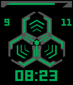
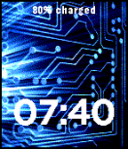

<!-- Generated by scripts/update_app_directory.py: do not edit by hand -->
[← All Pebble Developers](../developers.md)

# GrimbiXcode

*2 watchfaces · Last updated 2026-10-12 · [About these lists](../about-app-lists.md)*

Links: [Pebble App Store](https://apps.repebble.com/apps/dev/grimbixcode_55b726298ddce780e600002c) · [GitHub (GrimbixCode)](https://github.com/GrimbixCode) · [Website (microravez.ch)](http://www.microravez.ch/)

<button type="button" data-filter="all" aria-pressed="true">All 2</button><button type="button" data-filter="watchface" aria-pressed="false">Watchfaces 2</button><button type="button" data-filter="watchapp" aria-pressed="false" disabled>Apps 0</button>

<label class="dev-sort">Sort by <select><option value="updated">Recently updated</option><option value="released">Newest release</option><option value="title">A–Z</option></select></label>

<h2 class="app-name" id="app-55bb0551e54d9fc375000018"><a href="https://apps.repebble.com/55bb0551e54d9fc375000018">MicroRavez Watchface</a> v1.2</h2>
<a class="app-source" href="https://github.com/GrimbixCode/Pebble_MicroRavezWatchface.git" title="Source code" data-search-exclude>View source</a>

Watchface

GPL-2.0 Released 2015-07-31 Updated 2015-11-09

Runs on: Time 2, Time

This is the official Watchface of the Swiss Jump &amp; Shuffle Dance-Crew MicroRavez. Enjoy the Time with our smart Logo! Visit us on our Homepage.

<h2 class="app-name" id="app-55b89184a06a0e436e000030"><a href="https://apps.repebble.com/55b89184a06a0e436e000030">Simple Electronic Watchface</a> v1.1</h2>
<a class="app-source" href="https://github.com/GrimbixCode/Pebble_ElectronicWatchface" title="Source code" data-search-exclude>View source</a>

Watchface

GPL-2.0 Released 2015-07-29 Updated 2015-07-29

Runs on: Time 2, Pebble 2 Duo, Pebble 2, Time, Classic

Take a look at the time! ..with this simple Watchface. If you are interested in electronics, it&#x27;s the nicest way to watch the time through this face.

