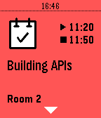

<!-- Generated by scripts/update_app_directory.py: do not edit by hand -->
[← All Pebble Developers](../developers.md)

# Grimborg

*1 watchface and 2 apps · Last updated 2026-10-12 · [About these lists](../about-app-lists.md)*

Links: [Pebble App Store](https://apps.repebble.com/apps/dev/grimborg_52c70e3b5ce57118c100000a) · [GitHub (grimborg)](https://github.com/grimborg) · [Website (golanguk.com)](http://golanguk.com)

<button type="button" data-filter="all" aria-pressed="true">All 3</button><button type="button" data-filter="watchface" aria-pressed="false">Watchfaces 1</button><button type="button" data-filter="watchapp" aria-pressed="false">Apps 2</button>

<label class="dev-sort">Sort by <select><option value="updated">Recently updated</option><option value="released">Newest release</option><option value="title">A–Z</option></select></label>

<h2 class="app-name" id="app-55c0b811718511f23900002e"><a href="https://apps.repebble.com/55c0b811718511f23900002e">GolangUK 2015</a> v1.0</h2>
<a class="app-source" href="http://github.com/grimborg/pebble-golanguk2015" title="Source code" data-search-exclude>View source</a>

App

GPL-3.0 Released 2015-08-04 Updated 2015-08-08

Runs on: Time 2, Pebble 2 Duo, Pebble 2, Time, Classic

The schedule of GolangUK 2015 on your wrist! Timeline support: 24h before the conference starts the sessions will appear in your timeline.

<h2 class="app-name" id="app-555b914f85693f7067000005"><a href="https://apps.repebble.com/555b914f85693f7067000005">PyGrunn 2015</a> v2.1</h2>
<a class="app-source" href="http://github.com/grimborg/pebble-pygrunn2015" title="Source code" data-search-exclude>View source</a>

App

No licence Released 2015-05-19 Updated 2015-05-20

Runs on: Time 2, Pebble 2 Duo, Pebble 2, Time, Classic

The schedule for PyGrunn 2015 on your wrist!

<h2 class="app-name" id="app-52f79494a374ba53ea000288"><a href="https://apps.repebble.com/52f79494a374ba53ea000288">L&#x27;hora en català</a> v1.0.1</h2>
<a class="app-source" href="https://bitbucket.org/grimborg/horacat" title="Source code" data-search-exclude>View source</a>

Watchface

Released 2014-02-09 Updated 2014-02-09

Runs on: Time 2, Pebble 2 Duo, Pebble 2, Time, Classic

The time in Catalan. This is a free watchface released under the GPLv3.

