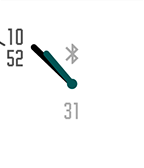

<!-- Generated by scripts/update_app_directory.py: do not edit by hand -->
[← All Pebble Developers](../developers.md)

# Gringer Apps

*3 watchfaces · Last updated 2026-10-11 · [About these lists](../about-app-lists.md)*

Links: [Pebble App Store](https://apps.repebble.com/apps/dev/gringer-apps_560c4f952dd2f15e90000009) · [GitHub (groyoh)](https://github.com/groyoh)

<button type="button" data-filter="all" aria-pressed="true">All 3</button><button type="button" data-filter="watchface" aria-pressed="false">Watchfaces 3</button><button type="button" data-filter="watchapp" aria-pressed="false" disabled>Apps 0</button>

<label class="dev-sort">Sort by <select><option value="updated">Recently updated</option><option value="released">Newest release</option><option value="title">A–Z</option></select></label>

<h2 class="app-name" id="app-56f93a5361a01637e5000036"><a href="https://apps.repebble.com/56f93a5361a01637e5000036">Minimalin</a> v1.7</h2>
<a class="app-source" href="https://github.com/groyoh/minimalin" title="Source code" data-search-exclude>View source</a>

Watchface

Released 2016-03-28 Updated 2016-11-18

Runs on: Round 2, Time 2, Pebble 2 Duo, Pebble 2, Time Round, Time, Classic

Minimalin is a fully customizable watchface that blends analog and digital for a simple, modern and elegant look. Minimalin is an open source project. If you love it as much as we do, feel free to…

<h2 class="app-name" id="app-56f6fa4191445b2baf000015"><a href="https://apps.repebble.com/56f6fa4191445b2baf000015">Easter Egg</a> v1.1</h2>
<a class="app-source" href="https://github.com/groyoh/easter_egg" title="Source code" data-search-exclude>View source</a>

Watchface

Released 2016-03-26 Updated 2016-03-27

Runs on: Round 2, Time 2, Time Round, Time

Celebrate Easter with this cute animated watchface (and some chocolate). Shake your wrist to wake up the little chick inside the egg. And… will you be able to find the hidden Easter egg? Designed…

<h2 class="app-name" id="app-56e98f4e3b537ac5fc00001b"><a href="https://apps.repebble.com/56e98f4e3b537ac5fc00001b">Paddy&#x27;s Day</a> v1.2</h2>
<a class="app-source" href="https://github.com/groyoh/paddys_day" title="Source code" data-search-exclude>View source</a>

Watchface

Released 2016-03-16 Updated 2016-03-26

Runs on: Round 2, Time 2, Time Round, Time

Celebrate Saint Patrick’s day with a dancing Irish leprechaun! See him dance every fifth minute or at the flick of your wrist. Designed by @AlessioLaiso and @Theresa_Phelan. Animated by…

