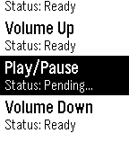

<!-- Generated by scripts/update_app_directory.py: do not edit by hand -->
[← All Pebble Developers](../developers.md)

# groundhogday

*1 app · Last updated 2026-10-11 · [About these lists](../about-app-lists.md)*

Links: [Pebble App Store](https://apps.repebble.com/apps/dev/groundhogday_566a7b7691873f15f800000e) · [GitHub (skonagaya)](https://github.com/skonagaya)

<h2 class="app-name" id="app-567af43af66b129c7200002b"><a href="https://apps.repebble.com/567af43af66b129c7200002b">HTTP Push</a> v3.2</h2>
<a class="app-source" href="https://github.com/skonagaya/HTTP-Push" title="Source code" data-search-exclude>View source</a>

App

Released 2015-12-23 Updated 2017-08-14

Runs on: Round 2, Time 2, Pebble 2 Duo, Pebble 2, Time Round, Time, Classic

A customizable HTTP request WatchApp perfect for Home Automation. The configuration page allows you to test requests before publishing to your Pebble. Configure any number of HTTP GET/POST…

