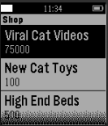
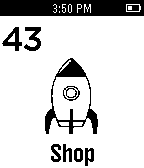

<!-- Generated by scripts/update_app_directory.py: do not edit by hand -->
[← All Pebble Developers](../developers.md)

# Grylis

*2 apps · Last updated 2026-10-12 · [About these lists](../about-app-lists.md)*

Links: [Pebble App Store](https://apps.repebble.com/apps/dev/grylis_551a8afcca2aa4bb58000074) · [GitHub (Grylis)](https://github.com/Grylis)

<button type="button" data-filter="all" aria-pressed="true">All 2</button><button type="button" data-filter="watchface" aria-pressed="false" disabled>Watchfaces 0</button><button type="button" data-filter="watchapp" aria-pressed="false">Apps 2</button>

<label class="dev-sort">Sort by <select><option value="updated">Recently updated</option><option value="released">Newest release</option><option value="title">A–Z</option></select></label>

<h2 class="app-name" id="app-561146339af99091be000007"><a href="https://apps.repebble.com/561146339af99091be000007">Kitty Clicker</a> v1.0</h2>
<a class="app-source" href="https://github.com/Grylis/kittycatclicker" title="Source code" data-search-exclude>View source</a>

App

No licence Released 2015-10-04 Updated 2015-10-04

Runs on: Time 2, Pebble 2 Duo, Pebble 2, Time, Classic

Kitty Clicker! This game is an incremental game for the Pebble watch that involves cats.

<h2 class="app-name" id="app-55e5ff7bd99ac93dd9000054"><a href="https://apps.repebble.com/55e5ff7bd99ac93dd9000054">Space Clicker</a> v1.0</h2>
<a class="app-source" href="https://github.com/Grylis/PebbleSpaceClicker" title="Source code" data-search-exclude>View source</a>

App

No licence Released 2015-09-01 Updated 2015-09-01

Runs on: Time 2, Pebble 2 Duo, Pebble 2, Time, Classic

This is an incremental game where you use your spaceship to earn science and improve NASA facilities.

