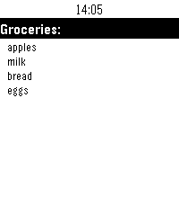

<!-- Generated by scripts/update_app_directory.py: do not edit by hand -->
[← All Pebble Developers](../developers.md)

# Grzegorz Koperwas

*1 app · Last updated 2026-11-02 · [About these lists](../about-app-lists.md)*

Links: [Pebble App Store](https://apps.repebble.com/apps/dev/grzegorz-koperwas_1fdd4941bdd71630e6a4c27b) · [GitHub (HakierGrzonzo)](https://github.com/HakierGrzonzo)

<h2 class="app-name" id="app-bc1c0d23d1994611bd94cbdd"><a href="https://apps.repebble.com/bc1c0d23d1994611bd94cbdd">pebbenote</a> v1.1.0</h2>
<a class="app-source" href="https://github.com/HakierGrzonzo/pebbenote" title="Source code" data-search-exclude>View source</a>

App

AGPL-3.0 Released 2026-10-25 Updated 2026-10-30

Runs on: Round 2, Time 2, Pebble 2 Duo, Pebble 2, Time Round, Time

Dictation note app, that is a bit better thanks to LLM that organizes it

