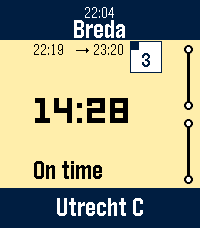

<!-- Generated by scripts/update_app_directory.py: do not edit by hand -->
[← All Pebble Developers](../developers.md)

# Guus H. Beckett

*1 app · Last updated 2026-10-12 · [About these lists](../about-app-lists.md)*

Links: [Pebble App Store](https://apps.repebble.com/apps/dev/guus-h-beckett_5ecdf9beefebcf2dc08bd8b0) · [GitHub (guusbeckett)](https://github.com/guusbeckett)

<h2 class="app-name" id="app-68f93536504cc500097101b9"><a href="https://apps.repebble.com/68f93536504cc500097101b9">Trein</a> v1.7.0</h2>
<a class="app-source" href="https://github.com/guusbeckett/trein-pebble" title="Source code" data-search-exclude>View source</a>

App · <a href="https://forum.rebble.io/t/597" title="Discuss this app on the Rebble forum" data-search-exclude>Forum thread</a>

GPL-3.0 Released 2025-10-22 Updated 2026-05-21

Runs on: Round 2, Time 2, Pebble 2 Duo, Pebble 2, Time Round, Time, Classic

A Pebble smartwatch app that shows live train information from Nederlandse Spoorwegen (Dutch Railways), including countdown to your next train, departure times, and platform information.

