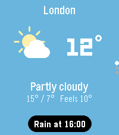
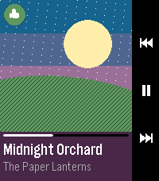
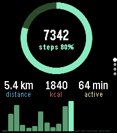

<!-- Generated by scripts/update_app_directory.py: do not edit by hand -->
[← All Pebble Developers](../developers.md)

# Gwil Kherve

*3 apps · Last updated 2026-11-23 · [About these lists](../about-app-lists.md)*

Links: [Pebble App Store](https://apps.repebble.com/apps/dev/gwil-kherve_ec189197541a4844acaa923a) · [GitHub (gkerherve)](https://github.com/gkerherve)

<button type="button" data-filter="all" aria-pressed="true">All 3</button><button type="button" data-filter="watchface" aria-pressed="false" disabled>Watchfaces 0</button><button type="button" data-filter="watchapp" aria-pressed="false">Apps 3</button>

<label class="dev-sort">Sort by <select><option value="updated">Recently updated</option><option value="released">Newest release</option><option value="title">A–Z</option></select></label>

<h2 class="app-name" id="app-71a6837724b2446db6bbc2d6"><a href="https://apps.repebble.com/71a6837724b2446db6bbc2d6">kWeather</a> v1.0.1</h2>
<a class="app-source" href="https://github.com/gkerherve/kWeather" title="Source code" data-search-exclude>View source</a>

App

No licence Released 2026-11-21 Updated 2026-11-21

Runs on: Round 2, Time 2, Pebble 2 Duo, Pebble 2, Time Round, Time, Classic

Beautiful weather for your Pebble, drawn by hand. NOW: a big weather icon, the temperature, high and low, how it feels, and a bubble telling you when it will rain. RAIN AND TEMPERATURE: the next…

<h2 class="app-name" id="app-a065110c3ab34985ba767ddc"><a href="https://apps.repebble.com/a065110c3ab34985ba767ddc">kMusic</a> v1.5.0</h2>
<a class="app-source" href="https://github.com/gkerherve/kMusic" title="Source code" data-search-exclude>View source</a>

App

No licence Released 2026-11-20 Updated 2026-11-21

Runs on: Round 2, Time 2, Pebble 2 Duo, Pebble 2, Time Round, Time, Classic

Now playing on your Pebble: the album cover, song, artist and progress from YouTube Music, Spotify or any Android music app, with Pebble-style controls. REQUIRES THE FREE ANDROID COMPANION APP…

<h2 class="app-name" id="app-b7458a6f5ff142c5be03cee5"><a href="https://apps.repebble.com/b7458a6f5ff142c5be03cee5">kHealth</a> v1.0.0</h2>
<a class="app-source" href="https://github.com/gkerherve/kHealth" title="Source code" data-search-exclude>View source</a>

App

No licence Released 2026-11-21 Updated 2026-11-21

Runs on: Round 2, Time 2, Pebble 2 Duo, Pebble 2, Time Round, Time, Classic

Everything Pebble Health knows, on four beautiful pages. TODAY: a steps ring against your usual day (a second ring when you beat it), distance, calories, active minutes and your steps hour by…

